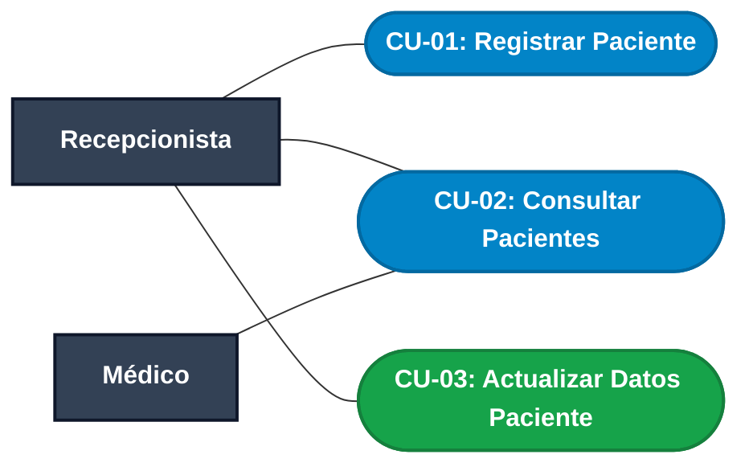
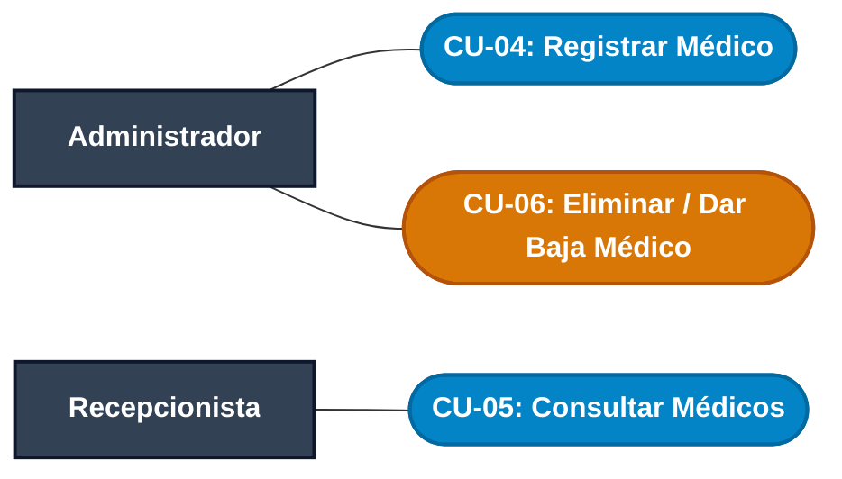
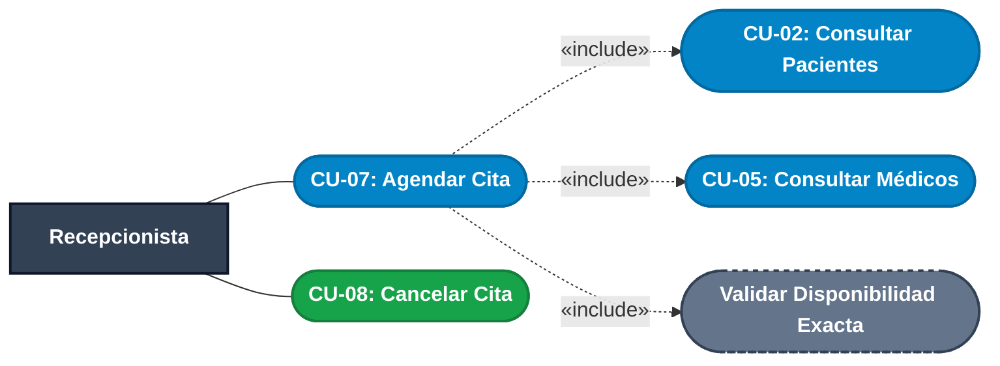
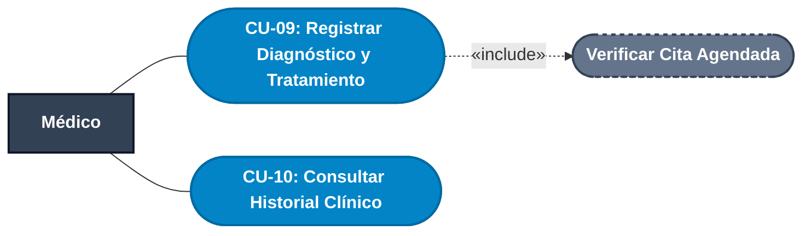

# FASE 3 — MODELADO UML: CASOS DE USO Y ESPECIFICACIÓN TÉCNICA
## Sistema de Gestión de Clínica Médica (SGCM - MVP)

**Autores:** Fabián Trujillo, Alexandra Garzón  
**Estándar de referencia:** UML 2.5 / Alineado con ERS IEEE Std 830-1998 (V5) y Matriz de Trazabilidad  

---

## 1. Introducción y Enfoque

Este documento consolida la especificación formal del **Diagrama de Casos de Uso** para el **Sistema de Gestión de Clínica Médica (SGCM)** en su versión de Producto Mínimo Viable (MVP). 

Los casos de uso representan el comportamiento funcional del sistema desde la perspectiva de los actores externos y garantizan una trazabilidad directa de $1:1$ con las **Historias de Usuario (HU-01 a HU-10)** y los **Requisitos Funcionales (RF-01 a RF-10)**.

> [!TIP]
> **Diagrama Consolidado en un Solo SVG:**  
> Puedes abrir e inspeccionar el nuevo diagrama vectorial completo con todos los 10 casos de uso integrados en [**`Diagrama_General_Casos_Uso_SGCM.drawio.svg`**](file:///c:/Users/USUARIO/Desktop/Sistema_Clinica_Medica/docs/phase-3-uml/use-cases/Diagrama_General_Casos_Uso_SGCM.drawio.svg). Está diseñado con alto contraste para garantizar lectura óptima en tema claro y oscuro, y es compatible tanto con visores web como con Draw.io / diagrams.net.

---

## 2. Actores del Sistema

| Actor | Tipo | Descripción y Responsabilidades |
| :--- | :--- | :--- |
| **Recepcionista** | Humano (Primario) | Personal operativo en ventanilla encargado de registrar y mantener los datos de pacientes, agendar y cancelar citas médicas, y consultar el catálogo de médicos disponibles. |
| **Médico** | Humano (Primario) | Profesional de salud que atiende las citas agendadas, consulta pacientes, examina el historial clínico previo y registra los diagnósticos y tratamientos de las consultas. |
| **Administrador del Sistema** | Humano (Secundario/Operativo) | Rol con privilegios administrativos responsable de dar de alta a nuevos médicos y gestionar la baja médica (CU-06), asegurando la integridad de las agendas. |

---

## 3. Diagrama General de Casos de Uso (Todos los Casos de Uso en un Solo Modelo)

A continuación se presenta el modelo consolidado del sistema con los 10 Casos de Uso del MVP:

```mermaid
graph TD
    classDef must fill:#0284c7,stroke:#0369a1,stroke-width:2px,color:#ffffff,font-weight:bold;
    classDef should fill:#16a34a,stroke:#15803d,stroke-width:2px,color:#ffffff,font-weight:bold;
    classDef could fill:#d97706,stroke:#b45309,stroke-width:2px,color:#ffffff,font-weight:bold;
    classDef actor fill:#334155,stroke:#0f172a,stroke-width:2px,color:#ffffff,font-weight:bold;
    classDef inc fill:#64748b,stroke:#334155,stroke-width:2px,stroke-dasharray: 4 4,color:#ffffff,font-weight:bold;

    %% Actores
    subgraph Actores ["Actores del Sistema"]
        R["Recepcionista"]:::actor
        A["Administrador"]:::actor
        M["Médico"]:::actor
    end

    %% Límite del Sistema
    subgraph SGCM ["Límite del Sistema: SGCM (MVP)"]
        subgraph Pacientes ["Módulo 1: Gestión de Pacientes"]
            CU01(["CU-01: Registrar Paciente (Must)"]):::must
            CU02(["CU-02: Consultar Pacientes (Must)"]):::must
            CU03(["CU-03: Actualizar Paciente (Should)"]):::should
        end

        subgraph Medicos ["Módulo 2: Gestión de Médicos"]
            CU04(["CU-04: Registrar Médico (Must)"]):::must
            CU05(["CU-05: Consultar Médicos (Must)"]):::must
            CU06(["CU-06: Eliminar/Dar Baja Médico (Could)"]):::could
        end

        subgraph Citas ["Módulo 3: Gestión de Citas"]
            CU07(["CU-07: Agendar Cita (Must Crítica)"]):::must
            CU08(["CU-08: Cancelar Cita (Should)"]):::should
            VAL_DISP(["Validar Disponibilidad Exacta"]):::inc
        end

        subgraph Historia ["Módulo 4: Historia Clínica"]
            CU09(["CU-09: Registrar Diagnóstico y Tratamiento (Must)"]):::must
            CU10(["CU-10: Consultar Historial Clínico (Must)"]):::must
            VERIF_CITA(["Verificar Cita Agendada"]):::inc
        end
    end

    %% Relaciones Actor -> CU
    R --- CU01
    R --- CU02
    R --- CU03
    R --- CU05
    R --- CU07
    R --- CU08

    A --- CU04
    A --- CU06

    M --- CU02
    M --- CU09
    M --- CU10

    %% Relaciones Include
    CU07 -.->|«include»| VAL_DISP
    CU07 -.->|«include»| CU02
    CU07 -.->|«include»| CU05
    CU09 -.->|«include»| VERIF_CITA
```

---

## 4. Casos de Uso Desglosados por Épica / Módulo

### 4.1. Módulo 1: Gestión de Pacientes
* **Diagrama Vectorial:** [`Categoria_1_GCM.drawio.svg`](file:///c:/Users/USUARIO/Desktop/Sistema_Clinica_Medica/docs/phase-3-uml/use-cases/Categoria_1_GCM.drawio.svg)
* **Alcance:**
  * **CU-01 (Must):** Registro de nuevos pacientes con validación de teléfono ($\ge 7$ dígitos numéricos) y campos obligatorios.
  * **CU-02 (Must):** Búsqueda y consulta de listado de pacientes.
  * **CU-03 (Should):** Actualización de datos de contacto (teléfono y dirección) de pacientes existentes.

---

### 4.2. Módulo 2: Gestión de Médicos
* **Diagrama Vectorial:** [`Categoria_2_GCM.drawio.svg`](file:///c:/Users/USUARIO/Desktop/Sistema_Clinica_Medica/docs/phase-3-uml/use-cases/Categoria_2_GCM.drawio.svg)
* **Alcance:**
  * **CU-04 (Must):** Alta de médicos con especialidad obligatoria y rango de edad válido (18-99 años).
  * **CU-05 (Must):** Visualización del directorio de profesionales médicos activos.
  * **CU-06 (Could):** Baja o eliminación de médico condicionada: bloqueada si el médico tiene citas futuras con estado `AGENDADA`.

---

### 4.3. Módulo 3: Gestión de Citas
* **Diagrama Vectorial:** [`Categoria_3_GCM.drawio.svg`](file:///c:/Users/USUARIO/Desktop/Sistema_Clinica_Medica/docs/phase-3-uml/use-cases/Categoria_3_GCM.drawio.svg)
* **Alcance:**
  * **CU-07 (Must - Crítica):** Agendamiento de cita en estado `AGENDADA`, validando previamente la no existencia de choque de horario en fecha y hora exacta para el médico seleccionado.
  * **CU-08 (Should):** Cancelación de una cita, actualizando su estado a `CANCELADA` (bloqueada si la cita ya fue `ATENDIDA`).

---

### 4.4. Módulo 4: Historia Clínica
* **Diagrama Vectorial:** [`Categoria_4_GCM.drawio.svg`](file:///c:/Users/USUARIO/Desktop/Sistema_Clinica_Medica/docs/phase-3-uml/use-cases/Categoria_4_GCM.drawio.svg)
* **Alcance:**
  * **CU-09 (Must):** Registro de diagnóstico y tratamiento para una cita en estado `AGENDADA`, transicionando su estado a `ATENDIDA`.
  * **CU-10 (Must):** Consulta del historial clínico cronológico del paciente con todas sus atenciones previas.

---

## 5. Tabla de Especificación Detallada (CU-01 a CU-10)

| ID Caso de Uso | Historia de Usuario | Requisito ERS | Actor Principal | Precondición | Flujo Básico (Éxito) | Flujo Alternativo / Excepciones | Postcondición | Prioridad |
| :--- | :--- | :--- | :--- | :--- | :--- | :--- | :--- | :--- |
| **CU-01** | HU-01 | RF-01 | Recepcionista | El usuario tiene acceso a la pantalla de pacientes. | Ingresa ID, nombre, edad, teléfono ($\ge 7$ dígitos) y dirección. El sistema valida y persiste el paciente. | Teléfono inválido o nombre vacío: el sistema bloquea y muestra mensaje de error. | Paciente registrado en base de datos. | **Must Have** |
| **CU-02** | HU-02 | RF-02 | Recepcionista / Médico | Existen o no registros en el sistema. | Solicita consultar listado. El sistema retorna la lista completa de pacientes activos. | Sin registros: retorna mensaje *"No hay registros de pacientes disponibles"*. | Datos desplegados en pantalla. | **Must Have** |
| **CU-03** | HU-03 | RF-03 | Recepcionista | Paciente registrado previamente en el sistema. | Busca por ID existente y modifica teléfono o dirección. Guarda cambios. | ID no existe: emite mensaje *"Paciente no encontrado"*. | Registro del paciente actualizado. | **Should Have** |
| **CU-04** | HU-04 | RF-04 | Administrador | Acceso al módulo de administración médica. | Ingresa ID, nombre, especialidad, edad (18-99) y teléfono. El sistema valida y registra. | Especialidad vacía o edad fuera de rango: el sistema rechaza el guardado. | Médico registrado con estado activo. | **Must Have** |
| **CU-05** | HU-05 | RF-05 | Recepcionista | Existen o no médicos en la persistencia. | Solicita consultar médicos. El sistema lista ID, nombre, especialidad y teléfono. | Si no existen registros: despliega *"No hay médicos registrados"*. | Catálogo de médicos presentado en pantalla. | **Must Have** |
| **CU-06** | HU-06 | RF-06 | Administrador | Médico registrado en el sistema. | Solicita baja de médico. El sistema verifica que no posea citas futuras `AGENDADA` y efectúa la baja lógica. | Médico con citas `AGENDADA` pendientes: sistema bloquea la baja y exige reasignación. | Médico marcado como inactivo o eliminado. | **Could Have** |
| **CU-07** | HU-07 | RF-07 | Recepcionista | Paciente y médico existen y están activos. | Selecciona paciente, médico, fecha y hora exacta. El sistema valida disponibilidad y crea cita en estado `AGENDADA`. | Conflicto de horario (médico ya ocupado en esa hora) o paciente inexistente: rechaza el agendamiento. | Cita registrada en estado `AGENDADA`. | **Must Have (Crítica)** |
| **CU-08** | HU-08 | RF-08 | Recepcionista | Cita agendada previamente. | Localiza cita por ID y confirma cancelación. El sistema cambia estado a `CANCELADA`. | Si la cita ya está en estado `ATENDIDA` o el ID no existe: bloqueo y alerta. | Cita actualizada a estado `CANCELADA`. | **Should Have** |
| **CU-09** | HU-09 | RF-09 | Médico | Paciente con cita en estado `AGENDADA` con el médico. | Selecciona cita, ingresa diagnóstico y tratamiento. El sistema guarda la consulta y transiciona la cita a `ATENDIDA`. | Diagnóstico vacío o cita no válida: error y rechazo de guardado. | Registro anexado al historial y cita marcada como `ATENDIDA`. | **Must Have** |
| **CU-10** | HU-10 | RF-10 | Médico | Paciente con historial en el sistema. | Ingresa ID de paciente. El sistema retorna todas las atenciones previas ordenadas cronológicamente. | Paciente sin historial previo: despliega *"El paciente no posee registros médicos previos"*. | Historial desplegado para consulta profesional. | **Must Have** |

---

## 6. Índice de Archivos Vectoriales Actualizados (`docs/phase-3-uml/use-cases/`)

Todos los archivos vectoriales han sido ajustados con paletas de alto contraste y fondos sólidos para garantizar perfecta visibilidad en cualquier entorno (incluyendo tema oscuro):

1. ⭐ [**`Diagrama_General_Casos_Uso_SGCM.drawio.svg`**](file:///c:/Users/USUARIO/Desktop/Sistema_Clinica_Medica/docs/phase-3-uml/use-cases/Diagrama_General_Casos_Uso_SGCM.drawio.svg): **Diagrama maestro único consolidado** con todos los 10 casos de uso (`CU-01` a `CU-10`), relaciones `«include»`, actores y delimitaciones de módulos.
2. [**`Importancia_GCM.drawio.svg`**](file:///c:/Users/USUARIO/Desktop/Sistema_Clinica_Medica/docs/phase-3-uml/use-cases/Importancia_GCM.drawio.svg): Diagrama general del sistema completo priorizado, con `CU-10` y contrastes de color corregidos.
3. [**`Categoria_1_GCM.drawio.svg`**](file:///c:/Users/USUARIO/Desktop/Sistema_Clinica_Medica/docs/phase-3-uml/use-cases/Categoria_1_GCM.drawio.svg): Diagrama modular de Pacientes (`CU-01` a `CU-03`).
4. [**`Categoria_2_GCM.drawio.svg`**](file:///c:/Users/USUARIO/Desktop/Sistema_Clinica_Medica/docs/phase-3-uml/use-cases/Categoria_2_GCM.drawio.svg): Diagrama modular de Médicos (`CU-04` a `CU-06`).
5. [**`Categoria_3_GCM.drawio.svg`**](file:///c:/Users/USUARIO/Desktop/Sistema_Clinica_Medica/docs/phase-3-uml/use-cases/Categoria_3_GCM.drawio.svg): Diagrama modular de Citas (`CU-07` y `CU-08`).
6. [**`Categoria_4_GCM.drawio.svg`**](file:///c:/Users/USUARIO/Desktop/Sistema_Clinica_Medica/docs/phase-3-uml/use-cases/Categoria_4_GCM.drawio.svg): Diagrama modular de Historia Clínica (`CU-09` y `CU-10`).
