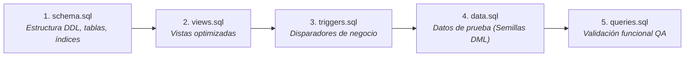

# FASE 4 — PUNTO 10: GUÍA DE EJECUCIÓN Y DESPLIEGUE DEL SCRIPT SQL
## Sistema de Gestión de Clínica Médica (SGCM - MVP)

**Autores:** Fabián Trujillo, Alexandra Garzón  
**Trazabilidad:** Historias de Usuario (HU-01 a HU-10), ERS IEEE 830 (V6) y Scripts `schema.sql`, `views.sql`, `triggers.sql`, `data.sql`.  
**Fase del Ciclo de Vida:** Fase 4 — Base de Datos y Persistencia.

---

## 1. Introducción y Arquitectura de Despliegue

Este manual proporciona las instrucciones técnicas, comandos de terminal y procedimientos de verificación para desplegar de manera reproducible y automatizada la base de datos del **Sistema de Gestión de Clínica Médica (SGCM)**.

El script principal [`schema.sql`](schema.sql) ha sido diseñado bajo estándares **ANSI SQL y PostgreSQL 14+**, con total compatibilidad para entornos de integración continua (CI/CD), contenedores Docker y motores embebidos para pruebas de desarrollo (como SQLite 3 o H2 Database).

---

## 2. Requisitos Previos del Entorno

* **Motor de Base de Datos Recomendado:** PostgreSQL 14, 15, 16 o superior.
* **Cliente de Base de Datos:** `psql` (CLI oficial) o interfaces gráficas como **pgAdmin 4**, **DBeaver Community** o **IntelliJ DataGrip**.
* **Alternativa en Contenedor:** Docker Desktop o Podman (opcional para no instalar servicios locales).
* **Codificación Requerida:** `UTF-8` (para soporte de tildes, caracteres especiales y nombres en español).

---

## 3. Secuencia y Orden Obligatorio de Ejecución

Para respetar la jerarquía de dependencias e integridad referencial, los scripts deben ejecutarse rigurosamente en el siguiente orden:



---

## 4. Métodos de Despliegue Paso a Paso

### Opción A: Despliegue en PostgreSQL Local con `psql` (Línea de Comandos)

1. **Abrir la terminal o PowerShell** en el directorio raíz del repositorio:
   ```bash
   cd c:/Users/Alexa_Var/Documents/Sistema_Clinica_Medica/docs/phase-4-bd
   ```

2. **Crear la base de datos** (si no existe):
   ```bash
   psql -U postgres -c "CREATE DATABASE clinica_medica_db ENCODING 'UTF8';"
   ```

3. **Ejecutar el script de esquema DDL (`schema.sql`):**
   ```bash
   psql -U postgres -d clinica_medica_db -f schema.sql
   ```

4. **Ejecutar las vistas y triggers:**
   ```bash
   psql -U postgres -d clinica_medica_db -f views.sql
   psql -U postgres -d clinica_medica_db -f triggers.sql
   ```

5. **Cargar los datos de prueba (`data.sql`):**
   ```bash
   psql -U postgres -d clinica_medica_db -f data.sql
   ```

---

### Opción B: Despliegue Automatizado con Docker (Recomendado para Desarrollo Limpio)

Si no deseas instalar PostgreSQL localmente en tu sistema operativo, puedes levantar una instancia aislada en un contenedor Docker con un único comando:

```bash
docker run --name sgcm-postgres \
  -e POSTGRES_DB=clinica_medica_db \
  -e POSTGRES_USER=clinica_user \
  -e POSTGRES_PASSWORD=ClinicaPass2026! \
  -p 5432:5432 \
  -v "${PWD}:/scripts" \
  -d postgres:16-alpine
```

Luego, ingresa al contenedor y ejecuta la secuencia:
```bash
docker exec -i sgcm-postgres psql -U clinica_user -d clinica_medica_db < schema.sql
docker exec -i sgcm-postgres psql -U clinica_user -d clinica_medica_db < views.sql
docker exec -i sgcm-postgres psql -U clinica_user -d clinica_medica_db < triggers.sql
docker exec -i sgcm-postgres psql -U clinica_user -d clinica_medica_db < data.sql
```

---

### Opción C: Despliegue Gráfico en pgAdmin 4 o DBeaver

1. Iniciar sesión en pgAdmin 4 y conectar al servidor PostgreSQL local.
2. Hacer clic derecho sobre `Databases` $\rightarrow$ `Create` $\rightarrow$ `Database...`, nombrar `clinica_medica_db`.
3. Abrir la herramienta de consultas (**Query Tool** - `Alt + Shift + Q`).
4. Abrir el archivo `schema.sql` (`Ctrl + O`), verificar el contenido y presionar **F5** (Execute).
5. Repetir la ejecución para `views.sql`, `triggers.sql` y `data.sql`.

---

## 5. Verificación Post-Despliegue

Para confirmar que la base de datos quedó en un estado 100% operativo y consistente, ejecuta las siguientes sentencias de diagnóstico:

### 5.1. Comprobar Existencia de las 5 Tablas
```sql
SELECT table_name, table_type 
FROM information_schema.tables 
WHERE table_schema = 'public' 
ORDER BY table_name;
```
* **Resultado Esperado:** 5 filas correspondientes a `citas`, `historias_clinicas`, `medicos`, `pacientes` y `registros_consulta`.

### 5.2. Comprobar Volumetría de Datos Cargados
```sql
SELECT 
    (SELECT COUNT(*) FROM pacientes) AS total_pacientes,
    (SELECT COUNT(*) FROM medicos) AS total_medicos,
    (SELECT COUNT(*) FROM historias_clinicas) AS total_historias,
    (SELECT COUNT(*) FROM citas) AS total_citas,
    (SELECT COUNT(*) FROM registros_consulta) AS total_registros_clinicos;
```
* **Resultado Esperado tras ejecutar `data.sql`:**
  * `total_pacientes`: 5
  * `total_medicos`: 5
  * `total_historias`: 5
  * `total_citas`: 5
  * `total_registros_clinicos`: 4

---

## 6. Resolución de Problemas Frecuentes (Troubleshooting)

| Error Común | Causa Raíz | Solución Inmediata |
| :--- | :--- | :--- |
| `ERROR: relation "pacientes" does not exist` | Se intentó ejecutar `data.sql` o `views.sql` antes de ejecutar `schema.sql`. | Ejecutar estrictamente primero `schema.sql` para crear las tablas base. |
| `ERROR: table "medicos" cannot be dropped because other objects depend on it` | Se ejecutó un `DROP TABLE` individual en orden incorrecto. | Usar `DROP TABLE ... CASCADE` como está codificado en la sección 0 de `schema.sql`. |
| `ERROR: character with byte sequence has no equivalent in encoding "UTF8"` | La consola o el archivo SQL no están configurados en UTF-8. | Guardar los archivos con codificación UTF-8 sin BOM y ejecutar `SET client_encoding TO 'UTF8';`. |
| `ERROR: duplicate key value violates unique constraint "uq_citas_medico_fecha_hora"` | Se intentó ingresar dos citas con el mismo médico y fecha/hora (**RN-02**). | Es el comportamiento esperado de validación. Verificar que los datos de prueba tengan horarios distintos. |
