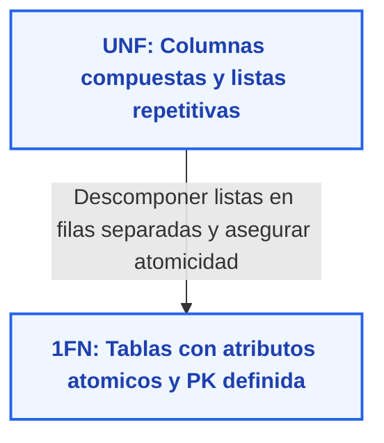
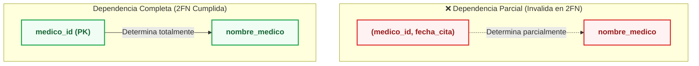
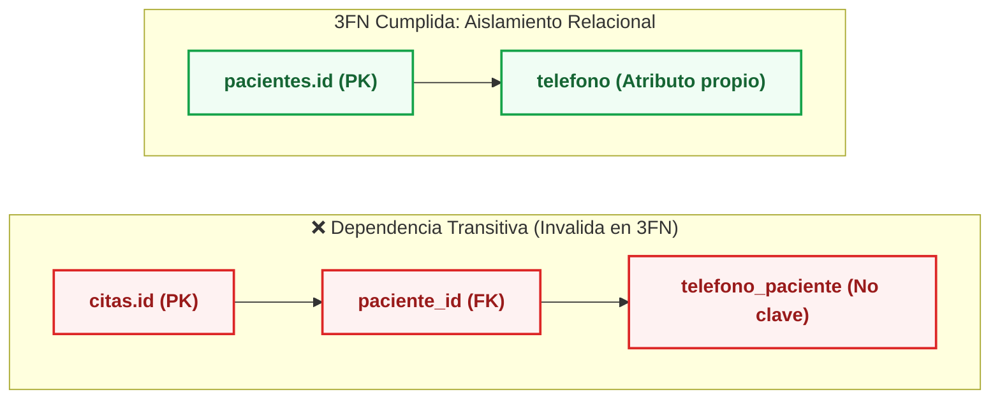

# FASE 4 — PUNTO 5: PROCESO FORMAL DE NORMALIZACIÓN (1FN, 2FN, 3FN)
## Sistema de Gestión de Clínica Médica (SGCM - MVP)

**Autores:** Fabián Trujillo, Alexandra Garzón  
**Trazabilidad:** Teoría Relacional de Codd, ERS IEEE 830 (V6) y Modelo de Datos SGCM.  
**Fase del Ciclo de Vida:** Fase 4 — Base de Datos y Persistencia.

---

## 1. Fundamentos y Objetivos de la Normalización

La **Normalización de bases de datos relacionales** es una técnica formal formulada originalmente por Edgar F. Codd que descompone esquemas complejos en relaciones más pequeñas y cohesivas. Sus objetivos cardinales son:

1. **Minimizar la Redundancia:** Almacenar cada dato exactamente en un solo lugar.
2. **Eliminar Anomalías Operativas:** Evitar fallos de consistencia al insertar, modificar o eliminar datos.
3. **Preservar Dependencias y Datos:** Garantizar una descomposición sin pérdida de información (*Lossless-Join Decomposition*).

A continuación se expone el proceso de normalización paso a paso desde el diseño preliminar no normalizado hasta la **Tercera Forma Normal (3FN)**.

---

## 2. Forma No Normalizada (UNF - Relación Universal)

Imaginemos un diseño inicial rudimentario en el que toda la atención médica se almacena en una única sábana de datos o planilla plana:

$$\text{PLANILLA\_CLINICA}(\underline{\text{id\_cita}}, \text{paciente\_id}, \text{nombre\_paciente}, \text{edad\_paciente}, \text{telefono\_paciente}, \text{direccion\_paciente},$$
$$\text{medico\_id}, \text{nombre\_medico}, \text{especialidad}, \text{fecha\_cita}, \text{estado\_cita}, \text{diagnosticos\_historial}, \text{tratamientos\_historial})$$

### Anomalías Severas del Modelo UNF:
* **Grupos Repetitivos:** `diagnosticos_historial` y `tratamientos_historial` contienen listas o múltiples entradas en una sola celda.
* **Redundancia Extrema:** El nombre, teléfono y dirección del paciente se repiten tantas veces como citas tenga programadas.
* **Anomalía de Inserción:** No es posible registrar un médico nuevo o un paciente nuevo en el sistema si aún no se le ha asignado una cita médica.
* **Anomalía de Eliminación:** Si se cancela o elimina una cita, se borra accidentalmente el paciente y el médico si era su único registro.
* **Anomalía de Actualización:** Si un médico cambia de teléfono o especialidad, habría que actualizar cientos de registros históricos con riesgo de inconsistencia.

---

## 3. Primera Forma Normal (1FN)

### Regla Teórica:
> *Una relación está en **1FN** si y solo si todos los atributos contienen valores atómicos (indivisibles dentro del dominio) y no existen grupos repetitivos, vectores o tablas anidadas dentro de una columna. Además, debe existir una clave primaria definida.*

### Aplicación al SGCM:
1. **Eliminación de Grupos Repetitivos:** Los diagnósticos y tratamientos se extraen de la planilla general y se modelan en su propia relación `registros_consulta`.
2. **Atomicidad de Campos:** Atributos como teléfono, edad y dirección se almacenan en columnas individuales atómicas.
3. **Definición de Claves:** Se definen claves primarias inequívocas para cada relación resultante.

---

## 4. Segunda Forma Normal (2FN)

### Regla Teórica:
> *Una relación está en **2FN** si está en **1FN** y **todo atributo no clave depende funcionalmente de manera completa de la clave primaria**, es decir, no existen dependencias parciales respecto a una clave primaria compuesta ($X \to Y$).*

### Aplicación al SGCM:
1. Si la cita tuviese como clave compuesta `(paciente_id, medico_id, fecha_hora)`, el `nombre_paciente` dependería solo de `paciente_id` (dependencia parcial).
2. **Resolución:**
   * Se aíslan los datos de los pacientes en la relación `pacientes` donde la clave es únicamente `id`.
   * Se aíslan los datos de los médicos en `medicos` donde la clave es únicamente `id`.
   * La relación `citas` adopta una clave subrogada simple (`id`), asegurando que todos sus atributos no clave (`fecha_hora`, `estado`, `motivo`) dependan estrictamente de la cita en su totalidad.
   * **Resultado:** No existen dependencias parciales en ninguna tabla. Se cumple 2FN al 100%.

---

## 5. Tercera Forma Normal (3FN)

### Regla Teórica:
> *Una relación está en **3FN** si está en **2FN** y **ningún atributo no clave depende transitivamente de la clave primaria** ($X \to Y \to Z$). En otros términos, no pueden existir dependencias funcionales entre atributos no clave.*

### Análisis Tabla por Tabla en el SGCM:

1. **Tabla `pacientes` ($\underline{\text{id}}$, $\text{nombre}$, $\text{edad}$, $\text{telefono}$, $\text{direccion}$, $\text{created\_at}$):**
   * Dependencias: $\text{id} \to \{\text{nombre}, \text{edad}, \text{telefono}, \text{direccion}, \text{created\_at}\}$.
   * Ningún atributo no clave determina a otro. **Cumple 3FN.**
2. **Tabla `medicos` ($\underline{\text{id}}$, $\text{nombre}$, $\text{edad}$, $\text{telefono}$, $\text{especialidad}$, $\text{activo}$, $\text{created\_at}$):**
   * Dependencias: $\text{id} \to \{\text{nombre}, \text{edad}, \text{telefono}, \text{especialidad}, \text{activo}, \text{created\_at}\}$.
   * La especialidad describe al médico, no al teléfono ni a la edad. **Cumple 3FN.**
3. **Tabla `historias_clinicas` ($\underline{\text{id}}$, $\text{paciente\_id}$, $\text{fecha\_creacion}$, $\text{created\_at}$):**
   * Dependencias: $\text{id} \to \{\text{paciente\_id}, \text{fecha\_creacion}, \text{created\_at}\}$.
   * Se almacena únicamente el identificador foráneo `paciente_id` sin duplicar nombre o teléfono. **Cumple 3FN.**
4. **Tabla `citas` ($\underline{\text{id}}$, $\text{paciente\_id}$, $\text{medico\_id}$, $\text{fecha\_hora}$, $\text{estado}$, $\text{motivo}$, $\text{created\_at}$):**
   * La tabla solo almacena las claves foráneas hacia `pacientes` y `medicos`. No contiene el nombre del doctor ni la dirección del paciente (lo cual violaría 3FN por transitividad).
   * Dependencias: $\text{id} \to \{\text{paciente\_id}, \text{medico\_id}, \text{fecha\_hora}, \text{estado}, \text{motivo}\}$. **Cumple 3FN.**
5. **Tabla `registros_consulta` ($\underline{\text{id}}$, $\text{historia\_clinica\_id}$, $\text{cita\_id}$, $\text{medico\_id}$, $\text{fecha\_hora}$, $\text{diagnostico}$, $\text{tratamiento}$, $\text{created\_at}$):**
   * Los datos clínicos (`diagnostico`, `tratamiento`) dependen directamente del acto médico identificado por `id`.
   * No se duplican datos del paciente ni del expediente. **Cumple 3FN.**

---

## 6. Demostración de Eliminación de Anomalías

| Anomalía Relacional | Estado Previo (UNF) | Estado Resuelto en 3FN (SGCM) |
| :--- | :--- | :--- |
| **Anomalía de Inserción** | No se podía dar de alta a un médico sin registrarle una cita. | Se inserta libremente en `medicos` sin requerir citas (`citas` es una relación separada). |
| **Anomalía de Modificación** | Modificar el teléfono de un paciente requería actualizar múltiples filas históricas. | Se actualiza en una **única fila** en la tabla `pacientes`. |
| **Anomalía de Borrado** | Cancelar una cita podía borrar al médico o al paciente si no tenían más citas. | Cancelar una cita solo actualiza su `estado = 'CANCELADA'` o elimina la tupla en `citas`; los datos maestros de `pacientes` y `medicos` permanecen intactos. |

---

## 7. Conclusión

El esquema de base de datos del **SGCM** satisface rigurosamente la **Tercera Forma Normal (3FN)**. Esto garantiza una estructura de persistencia óptima, libre de redundancias, altamente performante y preparada para escalar hacia la implementación en código en la Fase 6.
