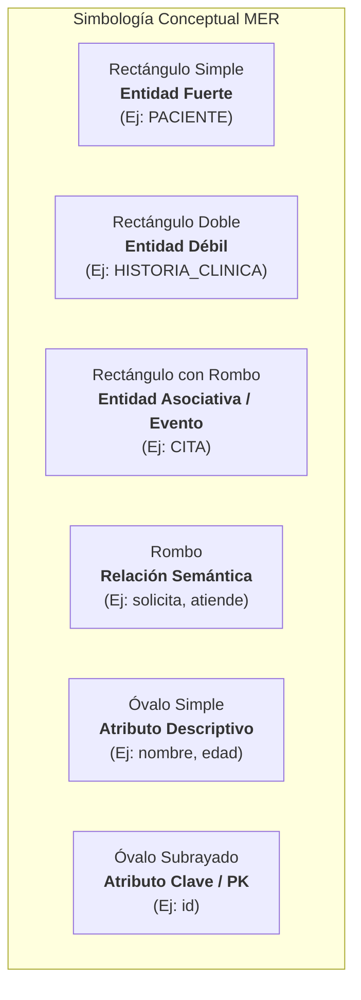
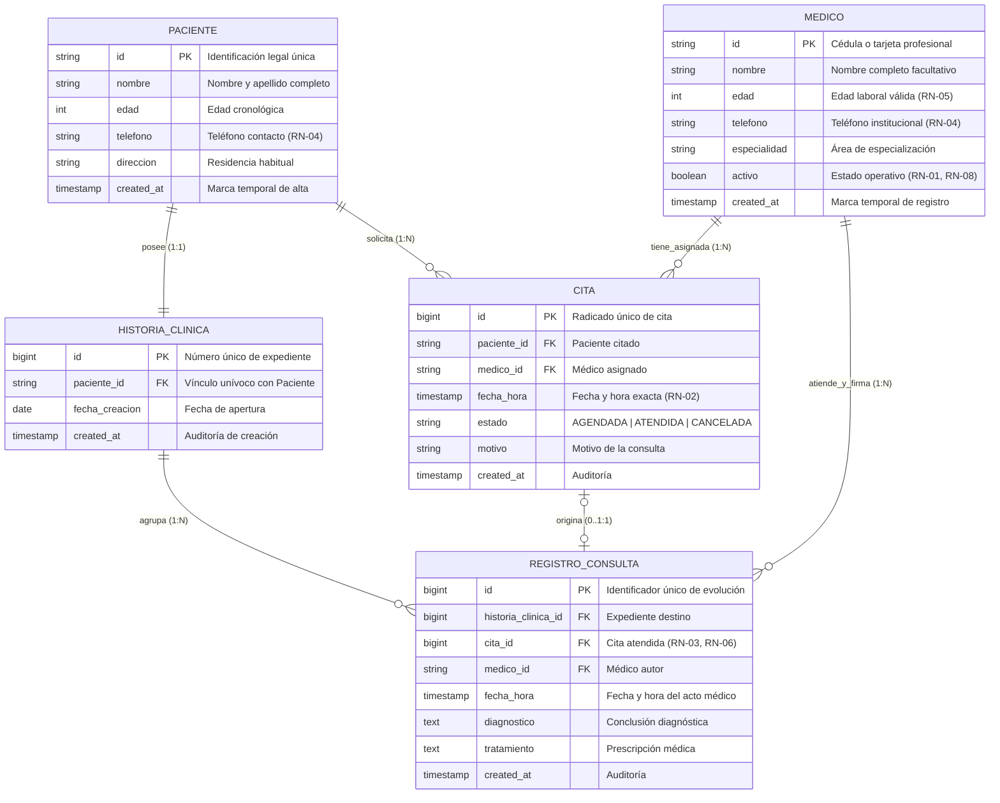

# FASE 4 — PUNTO 6: MODELO ENTIDAD-RELACIÓN (MER CONCEPTUAL)
## Sistema de Gestión de Clínica Médica (SGCM - MVP)

**Autores:** Fabián Trujillo, Alexandra Garzón  
**Trazabilidad:** Historias de Usuario (HU-01 a HU-10), ERS IEEE 830 (V6), Reglas de Negocio (RN-01 a RN-08) y Diagrama de Clases UML.  
**Fase del Ciclo de Vida:** Fase 4 — Base de Datos y Persistencia.

---

## 1. Introducción y Propósito

El **Modelo Entidad-Relación (MER)** es la representación conceptual formal de los datos y de las relaciones que rigen el dominio del **Sistema de Gestión de Clínica Médica (SGCM)**. Su objetivo es capturar la semántica de la información del mundo real clínica-paciente de forma independiente del Sistema Gestor de Bases de Datos (SGBD) que se implemente físicamente.

Este modelo traduce los requerimientos funcionales documentados en la ERS V6 y los casos de uso modelados en UML a un esquema gráfico riguroso que define las fronteras de los datos, las dependencias existenciales y las cardinalidades operativas.

El diagrama conceptual vectorial oficial se encuentra en:
* [**`Modelo_Entidad_Relacion_SGCM.svg`**](diagrams/Modelo_Entidad_Relacion_SGCM.svg)

---

## 2. Marco Teórico y Simbología Empleada

El modelo adopta los estándares de modelado conceptual propuestos por Peter Chen enriquecidos con la notación moderna de cardinalidad mínima y máxima $(min, max)$:

### 2.1. Tipología de Entidades
1. **Entidades Fuertes (Regulares):** Tienen existencia propia en el dominio clínico. No dependen de la existencia de otra entidad para subsistir.
   * `PACIENTE`: Existe independientemente de si tiene o no citas o historial previo.
   * `MEDICO`: Representa al profesional de la salud habilitado en la clínica.
2. **Entidades Débiles (Por Dependencia Existencial / Identificación):** Su ciclo de vida depende estrictamente de una entidad fuerte propietaria.
   * `HISTORIA_CLINICA`: No puede existir una historia clínica sin un paciente asociado ($1:1$).
   * `REGISTRO_CONSULTA`: Cada entrada clínica carece de significado sin el expediente del paciente al que pertenece.
3. **Entidades Asociativas / Transaccionales:** Nacen de la necesidad de modelar la interacción entre dos entidades fuertes con atributos propios del evento.
   * `CITA`: Vincula a `PACIENTE` con `MEDICO` en un instante temporal específico (`fecha_hora`) con un ciclo de vida propio (`estado`).

---

## 3. Diagrama Conceptual del Modelo Entidad-Relación

---

## 4. Análisis Detallado de Cardinalidades y Reglas de Negocio

La siguiente matriz desglosa formalmente las cardinalidades mínimas y máximas de cada relación, junto con la regla de negocio que la fundamenta:

| Relación Conceptual | Entidad Origen | Cardinalidad $(min, max)$ | Entidad Destino | Justificación y Regla de Negocio |
| :--- | :---: | :---: | :---: | :--- |
| **PACIENTE — HISTORIA_CLINICA** | `PACIENTE` | $(1, 1)$ | `HISTORIA_CLINICA` | **Relación 1 a 1 Estricta:** Todo paciente registrado debe tener exactamente un expediente clínico para garantizar trazabilidad legal. Si el paciente se retira, su historia se suprime en cascada (`ON DELETE CASCADE`). |
| **PACIENTE — CITA** | `PACIENTE` | $(0, N)$ | `CITA` | **Relación 1 a Muchos:** Un paciente recién registrado puede no tener citas programadas $(min=0)$, pero con el tiempo puede solicitar múltiples turnos médicos $(max=N)$. |
| **MEDICO — CITA** | `MEDICO` | $(0, N)$ | `CITA` | **Relación 1 a Muchos:** Un médico habilitado puede tener cero o múltiples citas en su agenda. **RN-08:** Un médico en estado inactivo (`activo = FALSE`) no puede recibir nuevas citas. **RN-01:** No puede eliminarse un médico con citas en estado `AGENDADA`. |
| **MEDICO — FECHA_HORA (Restricción de No Colisión)** | `MEDICO` | $(1, 1)$ por intervalo | `CITA` | **RN-02:** Un médico no puede tener dos citas activas en la misma fecha y hora exacta. En el modelo relacional se garantiza con la restricción `UNIQUE (medico_id, fecha_hora)`. |
| **HISTORIA_CLINICA — REGISTRO_CONSULTA** | `HISTORIA_CLINICA` | $(0, N)$ | `REGISTRO_CONSULTA` | **Composición 1 a Muchos:** Un expediente nuevo inicia vacío $(min=0)$ y va acumulando evoluciones médicas ordenadas cronológicamente $(max=N)$ para dar soporte a HU-10. |
| **MEDICO — REGISTRO_CONSULTA** | `MEDICO` | $(1, N)$ | `REGISTRO_CONSULTA` | **Asociación de Autoría:** Todo registro clínico debe estar firmado y atribuido a exactamente un médico tratante con tarjeta profesional válida. |
| **CITA — REGISTRO_CONSULTA** | `CITA` | $(0..1, 1)$ | `REGISTRO_CONSULTA` | **Vínculo Opcional 1 a 1:** Una cita puede no tener aún registro clínico (mientras esté `AGENDADA` o `CANCELADA`). Pero al atenderse, genera a lo sumo un registro clínico (**RN-06** y **RN-03**). |

---

## 5. Garantía de Coherencia con Fases Previas

1. **Con Fase 1 (Historias de Usuario):**
   * Las entidades `PACIENTE` y `MEDICO` materializan los actores de HU-01 a HU-06.
   * La entidad `CITA` modela los flujos de agendamiento (HU-07) y cancelación (HU-08).
   * Las entidades `HISTORIA_CLINICA` y `REGISTRO_CONSULTA` soportan el registro de diagnóstico (HU-09) y la consulta del historial (HU-10).
2. **Con Fase 2 (ERS IEEE 830 V6):**
   * Todas las restricciones de integridad y multiplicidad reflejan unívocamente las reglas `RN-01` a `RN-08`.
3. **Con Fase 3 (UML):**
   * Existe correspondencia 1:1 entre las clases del [Diagrama de Clases de Dominio](file:///c:/Users/Alexa_Var/Documents/Sistema_Clinica_Medica/docs/phase-3-uml/class-diagram/Diagrama_Clases_Dominio_GCM.svg) y las entidades del presente modelo conceptual.
