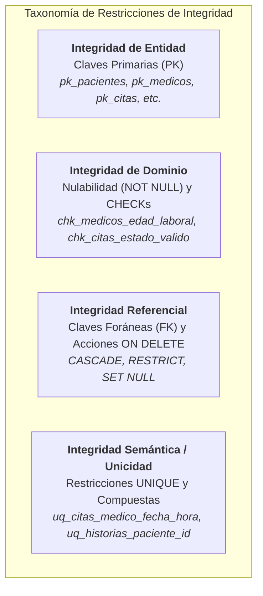

# FASE 4 — PUNTO 9: RESTRICCIONES DE INTEGRIDAD Y REGLAS DE NEGOCIO
## Sistema de Gestión de Clínica Médica (SGCM - MVP)

**Autores:** Fabián Trujillo, Alexandra Garzón  
**Trazabilidad:** Historias de Usuario (HU-01 a HU-10), ERS IEEE 830 (V6), Reglas de Negocio (RN-01 a RN-08) y Script `schema.sql`.  
**Fase del Ciclo de Vida:** Fase 4 — Base de Datos y Persistencia.

---

## 1. Introducción y Enfoque de Seguridad por Capas (Defense-in-Depth)

En arquitecturas de software de misión crítica como la gestión de salud, la base de datos no es un simple repositorio pasivo; es la **última línea de defensa de la integridad de los datos**. Si una validación de la interfaz gráfica o de los controladores del backend falla o es vulnerada, la base de datos debe rechazar atómicamente cualquier transacción inválida.

Este documento presenta la **matriz exhaustiva de restricciones de integridad** implementadas en el script `schema.sql`, vinculando formalmente cada constraint DDL con los requisitos funcionales y las **Reglas de Negocio (RN-01 a RN-08)** de la ERS V6.

---

## 2. Clasificación de Restricciones Implementadas

---

## 3. Matriz Exhaustiva de Restricciones vs Reglas de Negocio (RN-01 a RN-08)

| Nombre de Restricción DDL | Tabla Afectada | Tipo | Definición Técnica SQL | Regla ERS Mapeada | Comportamiento y Efecto en la Base de Datos |
| :--- | :--- | :---: | :--- | :---: | :--- |
| `pk_pacientes` | `pacientes` | `PK` | `PRIMARY KEY (id)` | RF-01 | Garantiza que no existan dos pacientes con la misma cédula/identificación legal. |
| `chk_pacientes_telefono_valido` | `pacientes` | `CHECK` | `LENGTH(TRIM(telefono)) >= 7 AND telefono ~ '^[0-9+\-\s]+$'` | **RN-04** / RF-01 | Impide guardar números de teléfono con menos de 7 dígitos o que contengan letras. |
| `chk_pacientes_edad_range` | `pacientes` | `CHECK` | `edad >= 0 AND edad <= 125` | RF-01 | Rechaza edades negativas o biológicamente inconsistentes. |
| `pk_medicos` | `medicos` | `PK` | `PRIMARY KEY (id)` | RF-04 | Asegura unicidad de la tarjeta profesional o identificación del médico. |
| `chk_medicos_edad_laboral` | `medicos` | `CHECK` | `edad >= 18 AND edad <= 99` | **RN-05** / RF-04 | Rechaza el alta de facultativos menores de edad o fuera del rango laboral permitido. |
| `chk_medicos_telefono_valido` | `medicos` | `CHECK` | `LENGTH(TRIM(telefono)) >= 7 AND telefono ~ '^[0-9+\-\s]+$'` | **RN-04** / RF-04 | Exige que el teléfono del médico tenga como mínimo 7 dígitos numéricos. |
| `uq_historias_paciente_id` | `historias_clinicas` | `UNIQUE` | `UNIQUE (paciente_id)` | RF-01, RF-10 | Impide la duplicidad de expedientes; un paciente tiene exactamente una historia clínica ($1:1$). |
| `fk_historias_paciente` | `historias_clinicas` | `FK` | `FOREIGN KEY (paciente_id) REFERENCES pacientes (id) ON DELETE CASCADE` | RF-01, RF-10 | Composición estricta: al eliminar un paciente, su expediente clínico se destruye en cascada. |
| `uq_citas_medico_fecha_hora` | `citas` | `UNIQUE` | `UNIQUE (medico_id, fecha_hora)` | **RN-02** / RF-07 | **Regla anti-colisión:** Impide físicamente insertar dos citas para el mismo médico en el mismo instante temporal. |
| `chk_citas_estado_valido` | `citas` | `CHECK` | `estado IN ('AGENDADA', 'ATENDIDA', 'CANCELADA')` | **RN-06, RN-07** / RF-07, RF-08 | Restringe el ciclo de vida de la cita a los tres únicos estados operativos permitidos. |
| `fk_citas_medico` | `citas` | `FK` | `FOREIGN KEY (medico_id) REFERENCES medicos (id) ON DELETE RESTRICT` | **RN-01, RN-08** / RF-06 | **Bloqueo de borrado físico:** Impide eliminar de la base de datos a un médico que tenga citas asignadas; exige baja lógica (`activo = FALSE`). |
| `fk_citas_paciente` | `citas` | `FK` | `FOREIGN KEY (paciente_id) REFERENCES pacientes (id) ON DELETE RESTRICT` | RF-01, RF-07 | Protege la auditoría de citas impidiendo la eliminación accidental de pacientes con turnos. |
| `uq_registros_cita_unica` | `registros_consulta` | `UNIQUE` | `UNIQUE (cita_id)` | **RN-06** / RF-09 | Garantiza que una misma cita agendada solo pueda generar una única atención y diagnóstico. |
| `fk_registros_historia` | `registros_consulta` | `FK` | `FOREIGN KEY (historia_clinica_id) REFERENCES historias_clinicas (id) ON DELETE CASCADE` | RF-09, RF-10 | Garantiza que las evoluciones clínicas se mantengan asociadas a su expediente o se limpien si este se retira. |
| `fk_registros_cita` | `registros_consulta` | `FK` | `FOREIGN KEY (cita_id) REFERENCES citas (id) ON DELETE SET NULL` | RF-09 | Si se depura administrativamente la tabla de citas, la evolución clínica en la historia médica no se pierde (`SET NULL`). |
| `fk_registros_medico` | `registros_consulta` | `FK` | `FOREIGN KEY (medico_id) REFERENCES medicos (id) ON DELETE RESTRICT` | RF-06, RF-09 | Impide eliminar a médicos que hayan firmado actos médicos o diagnósticos (responsabilidad médico-legal). |
| `chk_registros_diagnostico_not_empty` | `registros_consulta` | `CHECK` | `LENGTH(TRIM(diagnostico)) > 0` | RF-09 | Impide almacenar consultas sin diagnóstico médico o con cadenas de solo espacios en blanco. |
| `chk_registros_tratamiento_not_empty` | `registros_consulta` | `CHECK` | `LENGTH(TRIM(tratamiento)) > 0` | RF-09 | Impide almacenar consultas sin prescripción de tratamiento médico. |

---

## 4. Análisis Profundo de las Reglas de Negocio (RN-01 a RN-08)

### RN-01 & RN-08: Gestión de Baja Médica y Asignación de Citas
* **Enunciado ERS:** "No se permite dar de baja a un médico con citas activas AGENDADA. Un médico en estado inactivo no puede recibir nuevas citas."
* **Mecanismo de Base de Datos:**
  * La restricción `fk_citas_medico ... ON DELETE RESTRICT` impide borrar al médico mientras tenga registros en `citas`.
  * La columna `medicos.activo BOOLEAN DEFAULT TRUE` gestiona la baja lógica sin perder integridad referencial histórica.
  * El índice `idx_medicos_especialidad_activo` optimiza la consulta de recepción para ofrecer únicamente profesionales habilitados.

### RN-02: Prevención de Sobreagendamiento / Colisión Horaria
* **Enunciado ERS:** "No se permite agendar dos citas para el mismo médico en la misma fecha y hora exacta."
* **Mecanismo de Base de Datos:**
  * Restricción `uq_citas_medico_fecha_hora UNIQUE (medico_id, fecha_hora)`.
  * Cualquier intento de inserción concurrente que coincida en médico y fecha/hora arroja inmediatamente una excepción de violación de clave única (código PostgreSQL `23505 - unique_violation`), impidiendo matemáticamente la doble reserva sin depender exclusivamente de locks a nivel de aplicación.

### RN-04: Formato Telefónico Estricto
* **Enunciado ERS:** "El teléfono de pacientes y médicos debe ser numérico, con una longitud mínima de 7 dígitos."
* **Mecanismo de Base de Datos:**
  * Constraints `chk_pacientes_telefono_valido` y `chk_medicos_telefono_valido` mediante expresiones regulares ANSI/POSIX (`telefono ~ '^[0-9+\-\s]+$'` y `LENGTH(TRIM(telefono)) >= 7`).

### RN-05: Rango de Edad Laboral del Médico
* **Enunciado ERS:** "La edad del médico debe estar dentro del rango laboral legal (18 a 99 años)."
* **Mecanismo de Base de Datos:**
  * Restricción `chk_medicos_edad_laboral CHECK (edad >= 18 AND edad <= 99)`. Si se intenta ingresar un facultativo con 17 años o 100 años, el motor emite error `23514 - check_violation`.

### RN-06: Transición Unívoca de Cita a Registro Clínico
* **Enunciado ERS:** "Una cita solo pasa a estado ATENDIDA al registrar diagnóstico y tratamiento; no puede existir duplicidad de atención para una misma cita."
* **Mecanismo de Base de Datos:**
  * Restricción `uq_registros_cita_unica UNIQUE (cita_id)` en `registros_consulta`.
  * Asegura que una cita agendada solo pueda dar origen a un único registro de consulta médica en toda su historia.
