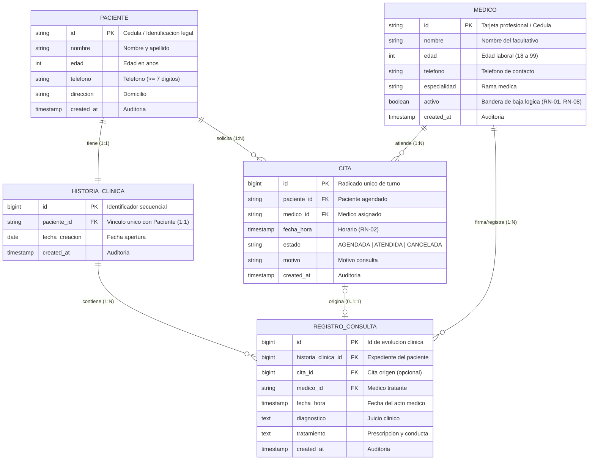

# FASE 4 — DISEÑO DE BASE DE DATOS Y PERSISTENCIA (SGCM)
## Sistema de Gestión de Clínica Médica (SGCM - MVP)

**Autores:** Fabián Trujillo, Alexandra Garzón  
**Trazabilidad:** Historias de Usuario (HU-01 a HU-10), ERS IEEE 830 (V6), Reglas de Negocio (RN-01 a RN-08) y Diagrama de Clases UML.  
**Motor Objetivo:** PostgreSQL 14+ / Compatible con ANSI SQL, MySQL 8+ y SQLite 3.

---

## 📁 Estructura del Directorio de la Fase 4

Para mantener los estándares de modularidad y orden de ingeniería, esta fase está organizada en tres subdirectorios especializados:

```text
docs/phase-4-bd/
├── README.md                      # Índice maestro de la Fase 4
├── documentation/                 # Documentación técnica paso a paso (01 al 11 + Diccionario)
│   ├── 01_identificar_entidades.md
│   ├── 02_definir_atributos.md
│   ├── 03_definir_claves_primarias.md
│   ├── 04_definir_relaciones.md
│   ├── 05_normalizacion.md
│   ├── 06_modelo_entidad_relacion.md
│   ├── 07_modelo_logico_relacional.md
│   ├── 08_crear_tablas_ddl.md
│   ├── 09_crear_restricciones.md
│   ├── 10_script_sql.md
│   ├── 11_datos_prueba_dml.md
│   └── diccionario_datos.md
├── scripts/                       # Scripts ejecutables SQL de base de datos
│   ├── schema.sql                 # Script DDL de tablas e índices
│   ├── data.sql                   # Script DML de semillas de prueba
│   ├── views.sql                  # Vistas optimizadas de negocio
│   ├── triggers.sql               # Automatizaciones y triggers de negocio
│   └── queries.sql                # Consultas DQL de validación y QA
└── diagrams/                      # Diagramas vectoriales de alta fidelidad (.svg)
    ├── Modelo_Entidad_Relacion_SGCM.svg
    └── Modelo_Logico_Relacional_SGCM.svg
```

---

## 🗺️ Índice Modular de Documentación (`documentation/`)

### Bloque A: Fundamentos y Análisis Conceptual
1. [**Punto 1: Identificación de Entidades**](documentation/01_identificar_entidades.md)
   * Clasificación de entidades fuertes (`PACIENTE`, `MEDICO`), débiles (`HISTORIA_CLINICA`, `REGISTRO_CONSULTA`) y transaccionales (`CITA`).
2. [**Punto 2: Definición de Atributos y Tipos de Datos**](documentation/02_definir_atributos.md)
   * Diccionario de campos, tipos SQL, nulabilidad (`NOT NULL`) y valores por defecto (`DEFAULT`).
3. [**Punto 3: Definición de Claves Primarias e Indexación**](documentation/03_definir_claves_primarias.md)
   * Claves naturales vs subrogadas (`BIGINT IDENTITY`), estrategia de indexación B-Tree y unicidad.
4. [**Punto 4: Definición de Relaciones y Cardinalidades**](documentation/04_definir_relaciones.md)
   * Cardinalidades ($1:1$, $1:N$, $0..1$), Claves Foráneas y acciones `ON DELETE CASCADE / RESTRICT / SET NULL`.
5. [**Punto 5: Proceso Formal de Normalización (1FN, 2FN, 3FN)**](documentation/05_normalizacion.md)
   * Descomposición formal desde UNF hasta 3FN, demostrando la eliminación de anomalías de inserción, borrado y modificación.

### Bloque B: Modelado Formal y Especificación Técnica
6. [**Punto 6: Especificación Formal del Modelo Entidad-Relación (MER)**](documentation/06_modelo_entidad_relacion.md)
   * Modelo conceptual formal, simbología Peter Chen/Crow's Foot, entidades fuertes/débiles/asociativas y matriz de cardinalidades.
7. [**Punto 7: Modelo Lógico Relacional (MLR)**](documentation/07_modelo_logico_relacional.md)
   * Esquema intensional de tablas, claves foráneas, reglas de transformación y matriz de integridad referencial.
8. [**Punto 8: Estructura DDL y Definición de Tablas**](documentation/08_crear_tablas_ddl.md)
   * Definición física DDL de las 5 tablas, tipos de almacenamiento, nulabilidad estricta y estrategia de índices B-Tree.
9. [**Punto 9: Restricciones de Integridad y Reglas de Negocio**](documentation/09_crear_restricciones.md)
   * Matriz de constraints (`CHECK`, `UNIQUE`, `FK`) vinculadas punto a punto con las reglas `RN-01` a `RN-08`.
10. [**Punto 10: Guía de Ejecución y Despliegue del Script SQL**](documentation/10_script_sql.md)
    * Manual de despliegue en PostgreSQL (`psql`, pgAdmin, Docker) y comandos de verificación post-instalación.
11. [**Punto 11: Catálogo y Trazabilidad de Datos de Prueba (DML)**](documentation/11_datos_prueba_dml.md)
    * Catálogo de semillas realistas y matriz de trazabilidad validando las 10 Historias de Usuario (HU-01 a HU-10).
12. [**Diccionario de Datos Consolidado y Volumetría**](documentation/diccionario_datos.md)
    * Catálogo formal de campos, tipos, longitudes, dominios y proyección de almacenamiento a 12 meses.

---

## 📊 Diagramas Vectoriales de Alta Fidelidad (`diagrams/`)

* [**`Modelo_Entidad_Relacion_SGCM.svg`**](diagrams/Modelo_Entidad_Relacion_SGCM.svg): Diagrama Entidad-Relación Conceptual.
* [**`Modelo_Logico_Relacional_SGCM.svg`**](diagrams/Modelo_Logico_Relacional_SGCM.svg): Diagrama Lógico Relacional de Tablas con notación Crow's Foot.



---

## 💾 Scripts de Base de Datos SQL (`scripts/`)

| Archivo SQL | Propósito Principal | Trazabilidad |
| :--- | :--- | :--- |
| [**`schema.sql`**](scripts/schema.sql) | Creación DDL de tablas, índices B-Tree y restricciones `CHECK` / `UNIQUE`. | RF-01 a RF-10 |
| [**`views.sql`**](scripts/views.sql) | Vistas optimizadas para recepción (`v_agenda_citas_recepcion`) e historia médica. | HU-07, HU-10 |
| [**`triggers.sql`**](scripts/triggers.sql) | Disparadores automáticos: alta de expediente (1:1) y transición a ATENDIDA (**RN-06**). | RN-06, RN-08 |
| [**`data.sql`**](scripts/data.sql) | Inserción de semillas realistas (5 pacientes, 5 médicos, 5 citas, 4 registros clínicos). | CP-01 a CP-10 |
| [**`queries.sql`**](scripts/queries.sql) | Batería DQL de validación funcional y pruebas negativas de reglas (**RN-01..RN-08**). | QA & Testing |
