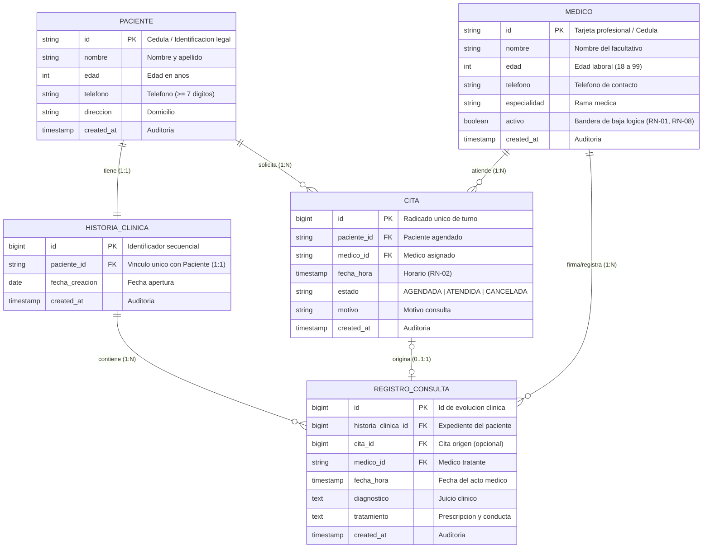

# FASE 4 — DISEÑO DE BASE DE DATOS Y PERSISTENCIA (SGCM)
## Sistema de Gestión de Clínica Médica (SGCM - MVP)

**Autores:** Fabián Trujillo, Alexandra Garzón  
**Trazabilidad:** Historias de Usuario (HU-01 a HU-10), ERS IEEE 830 (V6), Reglas de Negocio (RN-01 a RN-08) y Diagrama de Clases UML.  
**Motor Objetivo:** PostgreSQL 14+ / Compatible con ANSI SQL, MySQL 8+ y SQLite 3.

---

## 🗺️ Mapa de la Fase 4 (Paso a Paso Modular)

Esta fase contiene el desarrollo paso a paso del modelado y la persistencia relacional:

1. [**Punto 1: Identificación de Entidades**](file:///c:/Users/USUARIO/Desktop/Sistema_Clinica_Medica/docs/phase-4-bd/1_identificar_entidades.md)
   * Clasificación de entidades fuertes (`PACIENTE`, `MEDICO`), débiles (`HISTORIA_CLINICA`, `REGISTRO_CONSULTA`) y transaccionales (`CITA`).
2. [**Punto 2: Definición de Atributos y Tipos de Datos**](file:///c:/Users/USUARIO/Desktop/Sistema_Clinica_Medica/docs/phase-4-bd/2_definir_atributos.md)
   * Diccionario de campos, tipos SQL, nulabilidad (`NOT NULL`) y valores por defecto (`DEFAULT`).
3. [**Punto 3: Definición de Claves Primarias e Indexación**](file:///c:/Users/USUARIO/Desktop/Sistema_Clinica_Medica/docs/phase-4-bd/3_definir_claves_primarias.md)
   * Claves naturales vs subrogadas (`BIGINT IDENTITY`), estrategia de indexación B-Tree y unicidad.
4. [**Punto 4: Definición de Relaciones y Cardinalidades**](file:///c:/Users/USUARIO/Desktop/Sistema_Clinica_Medica/docs/phase-4-bd/4_definir_relaciones.md)
   * Cardinalidades ($1:1$, $1:N$, $0..1$), Claves Foráneas y acciones `ON DELETE CASCADE / RESTRICT / SET NULL`.
5. [**Punto 5: Proceso Formal de Normalización (1FN, 2FN, 3FN)**](file:///c:/Users/USUARIO/Desktop/Sistema_Clinica_Medica/docs/phase-4-bd/5_normalizacion.md)
   * Descomposición formal desde UNF hasta 3FN, demostrando la eliminación de anomalías de inserción, borrado y modificación.

---

## 📊 Diagramas Vectoriales de Alta Fidelidad (.svg)

* [**`Modelo_Entidad_Relacion_SGCM.svg`**](file:///c:/Users/USUARIO/Desktop/Sistema_Clinica_Medica/docs/phase-4-bd/diagrams/Modelo_Entidad_Relacion_SGCM.svg): Diagrama Entidad-Relación Conceptual.
* [**`Modelo_Logico_Relacional_SGCM.svg`**](file:///c:/Users/USUARIO/Desktop/Sistema_Clinica_Medica/docs/phase-4-bd/diagrams/Modelo_Logico_Relacional_SGCM.svg): Diagrama Lógico Relacional de Tablas con notación Crow's Foot.

---

## 💾 Scripts de Base de Datos SQL

* **Script DDL de Creación:** [**`schema.sql`**](file:///c:/Users/USUARIO/Desktop/Sistema_Clinica_Medica/docs/phase-4-bd/schema.sql)
  * Creación ordenada de tablas, índices de rendimiento y restricciones `CHECK` / `UNIQUE`.
* **Script DML de Datos de Prueba:** [**`data.sql`**](file:///c:/Users/USUARIO/Desktop/Sistema_Clinica_Medica/docs/phase-4-bd/data.sql)
  * Inserción de 5 pacientes, 5 médicos (con especialidades diversas y caso de baja lógica), 5 historias clínicas, 5 citas en diferentes estados y 4 registros clínicos evolutivos.
