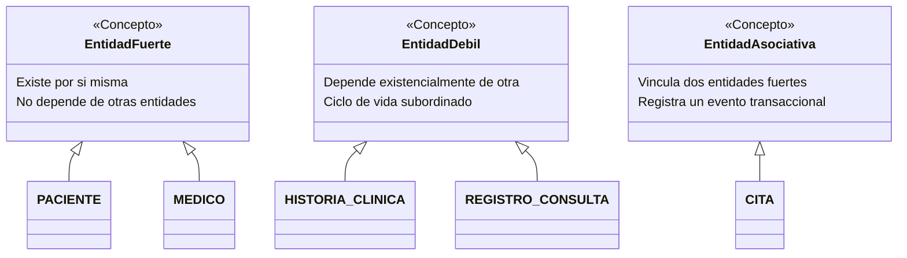

# FASE 4 — PUNTO 1: IDENTIFICACIÓN DE ENTIDADES
## Sistema de Gestión de Clínica Médica (SGCM - MVP)

**Autores:** Fabián Trujillo, Alexandra Garzón  
**Trazabilidad:** Historias de Usuario (HU-01 a HU-10), ERS IEEE 830 (V6) y Diagrama de Clases de Dominio UML 2.5.  
**Fase del Ciclo de Vida:** Fase 4 — Base de Datos y Persistencia.

---

## 1. Introducción y Enfoque

El modelado conceptual de la base de datos comienza con la **identificación de entidades**. En el contexto del **Sistema de Gestión de Clínica Médica (SGCM)**, una entidad representa cualquier objeto, concepto del mundo real o evento operativo del cual la clínica necesita registrar y mantener información persistente para su operación diaria.

A partir del análisis de las 4 épicas funcionales definidas en la Fase 1 y Fase 2, se identifican las entidades clave que sustentan el Producto Mínimo Viable (MVP).

---

## 2. Clasificación de Entidades del Dominio

Las entidades identificadas se clasifican según su naturaleza y dependencia existencial:

| Entidad | Tipo de Entidad | Justificación Arquitectónica | Trazabilidad ERS / HU |
| :--- | :--- | :--- | :--- |
| **`PACIENTE`** | Entidad Fuerte | Representa al usuario receptor del servicio de salud. Posee existencia propia y atributos independientes. | HU-01, HU-02, HU-03 (RF-01 a RF-03) |
| **`MEDICO`** | Entidad Fuerte | Representa al facultativo médico que presta los servicios asistenciales en la clínica. | HU-04, HU-05, HU-06 (RF-04 a RF-06) |
| **`HISTORIA_CLINICA`** | Entidad Débil por Composición | Expediente clínico único. No puede existir sin un paciente al cual pertenecer (dependencia de existencia $1:1$). | HU-09, HU-10 (RF-09, RF-10) |
| **`CITA`** | Entidad Asociativa / Transaccional | Materializa el agendamiento y turno médico entre un `PACIENTE` y un `MEDICO` en un instante temporal. | HU-07, HU-08 (RF-07, RF-08) |
| **`REGISTRO_CONSULTA`** | Entidad Débil / Evolutiva | Representa cada consulta, diagnóstico y tratamiento realizado por un médico dentro del expediente. | HU-09, HU-10 (RF-09, RF-10) |

---

## 3. Catálogo Detallado de Entidades

### 3.1. Entidad: `PACIENTE`
* **Definición:** Persona natural que acude a la clínica médica para recibir atención, programar citas o someterse a valoración médica.
* **Propósito de persistencia:** Mantener los datos demográficos y de contacto indispensables para la notificación de citas y la titularidad de su historia clínica.
* **Trazabilidad de negocio:**
  * **HU-01 (Must Have):** Registro con cédula/ID, nombre completo, edad, teléfono ($\ge 7$ dígitos) y dirección.
  * **HU-02 (Must Have):** Consulta y visualización del directorio de pacientes.
  * **HU-03 (Should Have):** Actualización de datos de contacto domiciliario y telefónico.

### 3.2. Entidad: `MEDICO`
* **Definición:** Profesional de la salud autorizado que labora en la institución, con una especialidad médica acreditada.
* **Propósito de persistencia:** Administrar la disponibilidad de profesionales, especialidades habilitadas y la firma responsable de los actos médicos.
* **Trazabilidad de negocio:**
  * **HU-04 (Must Have):** Registro con cédula/código profesional, nombre, especialidad médica y edad laboral (**RN-05:** 18 a 99 años).
  * **HU-05 (Must Have):** Directorio de profesionales médicos activos.
  * **HU-06 (Could Have):** Gestión de baja médica lógica mediante bandera `activo` (**RN-01, RN-08**), condicionada a no tener citas `AGENDADA` futuras.

### 3.3. Entidad: `HISTORIA_CLINICA`
* **Definición:** Expediente médico unificado y confidencial que consolida cronológicamente todos los antecedentes y consultas de un paciente.
* **Propósito de persistencia:** Garantizar la centralización de la información asistencial y el cumplimiento normativo en salud (composición $1:1$ estricta con `PACIENTE`).
* **Trazabilidad de negocio:**
  * **HU-09 & HU-10 (Must Have):** Servir como contenedor único de los asientos clínicos de cada paciente registrado.

### 3.4. Entidad: `CITA`
* **Definición:** Reservación y programación formal de un espacio de atención entre un paciente y un médico en fecha y hora específicas.
* **Propósito de persistencia:** Gestionar el flujo de turnos de la clínica, evitando colisiones horarias y coordinando la atención.
* **Ciclo de vida del estado:**
  $$\text{AGENDADA} \longrightarrow \begin{cases} \text{ATENDIDA} & \text{(Tras registrar consulta en HU-09 / RN-06)} \\ \text{CANCELADA} & \text{(Por solicitud del usuario en HU-08)} \end{cases}$$
* **Trazabilidad de negocio:**
  * **HU-07 (Must Have Crítica):** Creación de cita validando la no concurrencia horaria para el mismo médico (**RN-02**).
  * **HU-08 (Should Have):** Cancelación oportuna del turno para liberar agenda.

### 3.5. Entidad: `REGISTRO_CONSULTA`
* **Definición:** Registro específico del acto médico donde el doctor asienta la impresión diagnóstica, la evolución del paciente y la prescripción o tratamiento terapéutico.
* **Propósito de persistencia:** Preservar la evidencia jurídica y médica de la atención, vinculado al médico tratante y opcionalmente a la cita que lo originó.
* **Trazabilidad de negocio:**
  * **HU-09 (Must Have):** Registro formal de diagnóstico y tratamiento; transiciona la cita a `ATENDIDA` (**RN-06**).
  * **HU-10 (Must Have):** Consulta cronológica de los registros que componen la historia clínica.

---

## 4. Mapeo con el Diagrama de Clases UML (Fase 3)

En el Diagrama de Clases Orientado a Objetos (`Diagrama_Clases_Dominio_GCM.svg`), `Persona` fue modelada como una clase base abstracta de la cual heredan `Paciente` y `Medico`. 

Para el diseño de base de datos relacional:
* Se seleccionó la estrategia **Table Per Concrete Type (Tablas Concretas Independientes)**: crear las tablas `pacientes` y `medicos`.
* **Ventajas:** Máxima adherencia a 3FN, cero campos nulos, optimización de consultas directas y aislamiento estricto de las restricciones de dominio (ej. edad laboral de 18 a 99 años aplica exclusivamente a médicos).

---

## 5. Próximo Paso

Una vez identificadas las 5 entidades, el siguiente paso formal en el diseño es la especificación detallada de cada uno de sus campos en [**`02_definir_atributos.md`**](02_definir_atributos.md).
