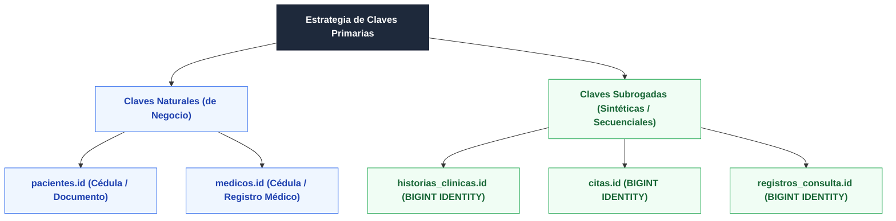

# FASE 4 — PUNTO 3: DEFINICIÓN DE CLAVES PRIMARIAS E INDEXACIÓN
## Sistema de Gestión de Clínica Médica (SGCM - MVP)

**Autores:** Fabián Trujillo, Alexandra Garzón  
**Trazabilidad:** Historias de Usuario (HU-01 a HU-10), ERS IEEE 830 (V6) y Modelo Relacional.  
**Fase del Ciclo de Vida:** Fase 4 — Base de Datos y Persistencia.

---

## 1. Fundamentos de las Claves Primarias (Primary Keys)

Una **Clave Primaria (PK)** es un atributo o conjunto mínimo de atributos que identifica unívocamente a cada tupla o registro dentro de una relación (tabla). En el estándar relacional y en la teoría de bases de datos de Codd, una clave primaria debe satisfacer obligatoriamente:

1. **Unicidad Estricta:** No pueden existir dos filas con el mismo valor de clave primaria dentro de la tabla.
2. **No Nulabilidad (Entidad Integrity):** Ningún componente de la clave primaria puede ser `NULL`.
3. **Inmutabilidad:** El valor de la clave no debe cambiar durante el ciclo de vida del registro.
4. **Indexación Física:** El motor de base de datos crea de forma automática un índice de árbol balanceado (B-Tree) sobre la clave primaria para asegurar búsquedas de tiempo $\mathcal{O}(\log n)$.

---

## 2. Tipos de Claves Primarias Utilizadas en el SGCM

En el diseño del sistema se combinan dos enfoques estratégicos según la naturaleza de la entidad:

### 2.1. Claves Naturales o de Negocio
* Se utilizan para `pacientes` y `medicos`.
* **Razón:** En el sector de la salud, las personas ya poseen un identificador legal único en el mundo real (cédula de ciudadanía, documento nacional o tarjeta médica profesional). Utilizarlo directamente como PK:
  * Evita la creación de columnas redundantes.
  * Facilita búsquedas directas cuando el recepcionista solicita la cédula en ventanilla (**HU-01, HU-02**).
  * Previene la duplicación inadvertida de un mismo paciente o médico en la base de datos.

### 2.2. Claves Subrogadas / Secuenciales
* Se utilizan para `historias_clinicas`, `citas` y `registros_consulta`.
* **Razón:** Las citas y registros de consulta son eventos transaccionales repetitivos en el tiempo. Crear claves compuestas complejas (como `(paciente_id, medico_id, fecha_hora)`) degradaría el rendimiento de las consultas y generaría claves foráneas pesadas en tablas dependientes. Se opta por `BIGINT GENERATED ALWAYS AS IDENTITY`.

---

## 3. Matriz de Claves Primarias y Candidatas

| Tabla | Clave Primaria (PK) | Tipo SQL | Justificación Técnica | Clave Candidata / Alternativa |
| :--- | :--- | :--- | :--- | :--- |
| **`pacientes`** | `id` | `VARCHAR(20)` | Cédula del paciente; previene duplicados en ventanilla. | Ninguna |
| **`medicos`** | `id` | `VARCHAR(20)` | Cédula o número de registro médico oficial. | Ninguna |
| **`historias_clinicas`** | `id` | `BIGINT IDENTITY` | Clave técnica secuencial compacta y eficiente. | `paciente_id` (`UNIQUE`, relación $1:1$) |
| **`citas`** | `id` | `BIGINT IDENTITY` | Radicado / consecutivo unívoco de cita para el usuario. | `(medico_id, fecha_hora)` (`UNIQUE`, **RN-02**) |
| **`registros_consulta`** | `id` | `BIGINT IDENTITY` | Identificador único de auditoría médica. | `cita_id` (`UNIQUE`, **RN-06**, opcional) |

---

## 4. Estrategia de Indexación Vinculada a las Claves

Además del índice B-Tree creado automáticamente por la restricción `PRIMARY KEY`, se definen índices explícitos sobre las claves foráneas y combinaciones críticas:

1. **`idx_citas_medico_fecha` en `citas(medico_id, fecha_hora)`:**  
   Garantiza que la validación de conflicto de horario (**HU-07 / RN-02**) se resuelva en memoria en milisegundos sin realizar un escaneo completo de la tabla (*Seq Scan*).
2. **`idx_registros_historia_fecha` en `registros_consulta(historia_clinica_id, fecha_hora DESC)`:**  
   Optimiza la Historia de Usuario **HU-10**, permitiendo recuperar todo el expediente de un paciente ordenado de la consulta más reciente a la más antigua con costo mínimo.
3. **`uq_historias_paciente_id` en `historias_clinicas(paciente_id)`:**  
   Crea un índice único que garantiza la cardinalidad estricta $1:1$ entre paciente y su historia clínica.

---

## 5. Próximo Paso

Una vez asegurada la identidad única de cada entidad, el siguiente paso formal es modelar los vínculos e integridad referencial en [**`04_definir_relaciones.md`**](04_definir_relaciones.md).
