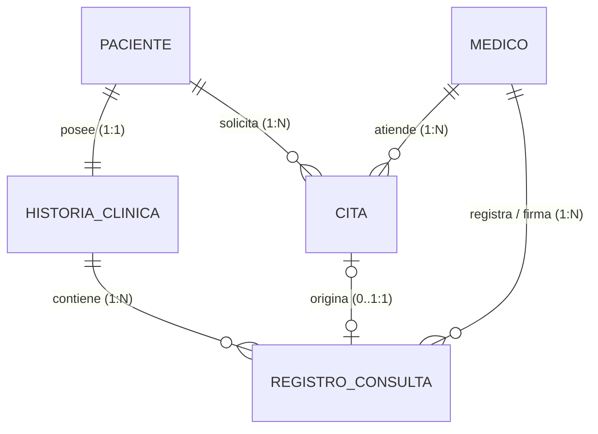

# FASE 4 — PUNTO 4: DEFINICIÓN DE RELACIONES Y CARDINALIDADES
## Sistema de Gestión de Clínica Médica (SGCM - MVP)

**Autores:** Fabián Trujillo, Alexandra Garzón  
**Trazabilidad:** Historias de Usuario (HU-01 a HU-10), ERS IEEE 830 (V6) y Reglas de Negocio (RN-01 a RN-08).  
**Fase del Ciclo de Vida:** Fase 4 — Base de Datos y Persistencia.

---

## 1. Fundamentos de las Relaciones Relacionales

En una base de datos relacional, las **relaciones** establecen cómo interactúan y se vinculan las entidades entre sí mediante el mecanismo de **Claves Foráneas (Foreign Keys - FK)**. Una clave foránea es una columna o conjunto de columnas en una tabla secundaria que hace referencia a la clave primaria de una tabla principal, asegurando el principio fundamental de **Integridad Referencial**: *no pueden existir referencias huérfanas en el sistema*.

---

## 2. Mapa Global de Relaciones y Cardinalidades

---

## 3. Detalle de Relaciones por Entidad

### 3.1. Relación 1 a 1: `PACIENTE` ⟷ `HISTORIA_CLINICA`
* **Semántica:** Cada paciente registrado en la clínica posee exactamente **una única** historia clínica, y cada historia clínica pertenece exclusivamente a un solo paciente.
* **Mecanismo técnico:**
  * La tabla `historias_clinicas` incluye la columna `paciente_id` como clave foránea hacia `pacientes(id)`.
  * Se aplica una restricción de unicidad estricta `UNIQUE (paciente_id)`.
* **Políticas de Integridad Referencial:**
  * **`ON UPDATE CASCADE`:** Si se actualiza el documento del paciente, la historia se propaga automáticamente.
  * **`ON DELETE CASCADE`:** Al ser una composición fuerte, si un paciente es eliminado, su expediente clínico se elimina con él.

---

### 3.2. Relación 1 a N: `PACIENTE` ⟷ `CITA`
* **Semántica:** Un paciente puede solicitar cero, una o muchas citas a lo largo del tiempo ($0..N$). Cada cita pertenece forzosamente a un único paciente ($1..1$).
* **Mecanismo técnico:**
  * La tabla `citas` incluye la clave foránea `paciente_id` que referencia a `pacientes(id)`.
* **Políticas de Integridad Referencial:**
  * **`ON UPDATE CASCADE`:** Actualiza automáticamente el vínculo si cambia el ID.
  * **`ON DELETE RESTRICT`:** **Regla de protección:** Prohibido eliminar a un paciente que cuente con citas históricas o programadas en el sistema.

---

### 3.3. Relación 1 a N: `MEDICO` ⟷ `CITA`
* **Semántica:** Un médico puede tener asignadas cero, una o múltiples citas en su agenda ($0..N$). Toda cita agendada está asignada a un único médico responsable ($1..1$).
* **Mecanismo técnico:**
  * La tabla `citas` incluye la clave foránea `medico_id` que referencia a `medicos(id)`.
  * **Regla de Negocio RN-02 (Anti-colisión):** Se complementa con una restricción `UNIQUE (medico_id, fecha_hora)` para evitar empalmes de turnos.
* **Políticas de Integridad Referencial:**
  * **`ON UPDATE CASCADE`:** Propaga cambios en el ID del médico.
  * **`ON DELETE RESTRICT`:** **Regla RN-08:** Prohíbe la eliminación física de un médico si tiene citas asignadas. Para prescindir de sus servicios se debe emplear la baja lógica (`activo = FALSE`) tras cancelar o reasignar sus citas activas (**HU-06**).

---

### 3.4. Relación 1 a N: `HISTORIA_CLINICA` ⟷ `REGISTRO_CONSULTA`
* **Semántica:** Una historia clínica acumula cronológicamente cero o muchos registros evolutivos de consulta médica ($0..N$). Cada registro pertenece estrictamente a una historia clínica ($1..1$).
* **Mecanismo técnico:**
  * La tabla `registros_consulta` incluye `historia_clinica_id` referenciando a `historias_clinicas(id)`.
* **Políticas de Integridad Referencial:**
  * **`ON UPDATE CASCADE`:** Propagación de modificaciones.
  * **`ON DELETE CASCADE`:** Si se elimina la historia clínica, se eliminan todas sus entradas evolutivas.

---

### 3.5. Relación 1 a N: `MEDICO` ⟷ `REGISTRO_CONSULTA`
* **Semántica:** Un médico puede emitir y firmar múltiples diagnósticos y tratamientos en diferentes consultas ($0..N$). Todo acto médico debe identificar inalterablemente al médico tratante responsable ($1..1$).
* **Mecanismo técnico:**
  * La tabla `registros_consulta` incluye `medico_id` referenciando a `medicos(id)`.
* **Políticas de Integridad Referencial:**
  * **`ON DELETE RESTRICT`:** Prohíbe terminantemente borrar a un médico que haya firmado un acto médico, salvaguardando la validez legal y trazabilidad de la historia clínica.

---

### 3.6. Relación Opcional 0..1 a 1: `CITA` ⟷ `REGISTRO_CONSULTA`
* **Semántica:** Una cita médica en estado `ATENDIDA` puede dar origen a un único registro de consulta (**HU-09 / RN-06**). Asimismo, pueden existir atenciones de urgencia o valoraciones que se asienten en el expediente sin haber pasado por un agendamiento previo de ventanilla (`cita_id` puede ser `NULL`).
* **Mecanismo técnico:**
  * La tabla `registros_consulta` incluye `cita_id` referenciando a `citas(id)`.
  * Se aplica una restricción `UNIQUE (cita_id)` para asegurar que una misma cita nunca genere registros duplicados.
* **Políticas de Integridad Referencial:**
  * **`ON DELETE SET NULL`:** Si por razones administrativas una cita fuese depurada, el registro médico sustantivo no se destruye; el puntero a la cita se fija en `NULL`.

---

## 4. Matriz Resumen de Integridad Referencial (DDL Foreign Keys)

| Clave Foránea (FK) | Tabla Origen | Columna FK | Tabla Destino | Columna PK | Cardinalidad | ON DELETE | ON UPDATE |
| :--- | :--- | :--- | :--- | :--- | :---: | :---: | :---: |
| `fk_historias_paciente` | `historias_clinicas` | `paciente_id` | `pacientes` | `id` | $1 : 1$ | `CASCADE` | `CASCADE` |
| `fk_citas_paciente` | `citas` | `paciente_id` | `pacientes` | `id` | $1 : N$ | `RESTRICT` | `CASCADE` |
| `fk_citas_medico` | `citas` | `medico_id` | `medicos` | `id` | $1 : N$ | `RESTRICT` | `CASCADE` |
| `fk_registros_historia` | `registros_consulta` | `historia_clinica_id` | `historias_clinicas` | `id` | $1 : N$ | `CASCADE` | `CASCADE` |
| `fk_registros_medico` | `registros_consulta` | `medico_id` | `medicos` | `id` | $1 : N$ | `RESTRICT` | `CASCADE` |
| `fk_registros_cita` | `registros_consulta` | `cita_id` | `citas` | `id` | $0..1 : 1$ | `SET NULL` | `CASCADE` |

---

## 5. Próximo Paso

Una vez formalizadas las relaciones, el siguiente paso es demostrar rigurosamente que el esquema cumple con las Formas Normales de la teoría relacional en [**`05_normalizacion.md`**](05_normalizacion.md).
