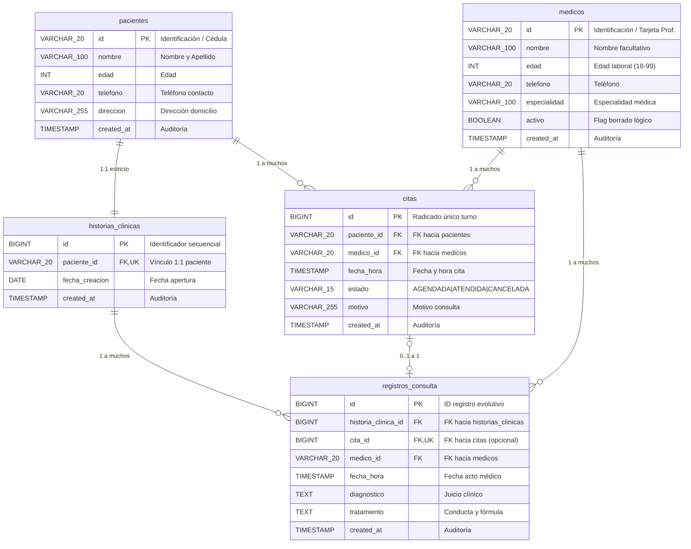

# FASE 4 — PUNTO 7: MODELO LÓGICO RELACIONAL
## Sistema de Gestión de Clínica Médica (SGCM - MVP)

**Autores:** Fabián Trujillo, Alexandra Garzón  
**Trazabilidad:** Historias de Usuario (HU-01 a HU-10), ERS IEEE 830 (V6), Reglas de Negocio (RN-01 a RN-08) y Modelo Entidad-Relación Conceptual.  
**Fase del Ciclo de Vida:** Fase 4 — Base de Datos y Persistencia.

---

## 1. Introducción y Transformación Conceptual a Lógico

El **Modelo Lógico Relacional (MLR)** es el puente entre el modelo conceptual abstracto (MER) y la implementación física en un Sistema Gestor de Bases de Datos Relacionales (RDBMS). Transforma las entidades y relaciones identificadas en un conjunto de **relaciones (tablas)**, **atributos (columnas)**, **claves primarias (PK)** y **claves foráneas (FK)** que garantizan integridad referencial y ausencia de redundancias (cumpliendo 3FN).

El diagrama lógico oficial con notación Crow's Foot se encuentra en:
* [**`Modelo_Logico_Relacional_SGCM.svg`**](../diagrams/Modelo_Logico_Relacional_SGCM.svg)

---

## 2. Notación Estándar y Reglas de Transformación Aplicadas

Para transformar el MER conceptual en el esquema relacional lógico se aplicaron las siguientes reglas canónicas:

1. **Transformación de Entidades Fuertes:** Se convierten directamente en tablas donde su clave primaria natural o de negocio funge como PK (`pacientes`, `medicos`).
2. **Transformación de Relaciones 1:1 Débiles:** La clave primaria de la entidad fuerte propietaria migra como clave foránea única (`UNIQUE`) a la entidad débil subordinada (`historias_clinicas.paciente_id -> pacientes.id`).
3. **Transformación de Relaciones 1:N:** La clave primaria del lado "1" migra como clave foránea a la tabla del lado "N" (`citas.paciente_id`, `citas.medico_id`, `registros_consulta.historia_clinica_id`, `registros_consulta.medico_id`).
4. **Transformación de Relaciones Opcionales 1:1:** La clave primaria de `citas` migra a `registros_consulta` como atributo anulable con restricción de unicidad (`registros_consulta.cita_id UNIQUE`).

---

## 3. Diagrama Lógico Relacional (Notación Crow's Foot)

---

## 4. Esquema Relacional de Tablas (Notación Intensional)

El esquema formal del SGCM en notación matemática relacional se define a continuación (subrayado simple = Clave Primaria; línea discontinua o cursiva = Clave Foránea):

1. **`pacientes`** (<ins>`id`</ins>, `nombre`, `edad`, `telefono`, `direccion`, `created_at`)
   * **PK:** `{id}`

2. **`medicos`** (<ins>`id`</ins>, `nombre`, `edad`, `telefono`, `especialidad`, `activo`, `created_at`)
   * **PK:** `{id}`

3. **`historias_clinicas`** (<ins>`id`</ins>, *`paciente_id`*, `fecha_creacion`, `created_at`)
   * **PK:** `{id}`
   * **FK:** `{paciente_id}` $\rightarrow$ `pacientes(id)`
   * **UK:** `{paciente_id}` (Garantiza relación 1:1 con `pacientes`)

4. **`citas`** (<ins>`id`</ins>, *`paciente_id`*, *`medico_id`*, `fecha_hora`, `estado`, `motivo`, `created_at`)
   * **PK:** `{id}`
   * **FK1:** `{paciente_id}` $\rightarrow$ `pacientes(id)`
   * **FK2:** `{medico_id}` $\rightarrow$ `medicos(id)`
   * **UK:** `{medico_id, fecha_hora}` (Garantiza regla de no sobreagendamiento **RN-02**)

5. **`registros_consulta`** (<ins>`id`</ins>, *`historia_clinica_id`*, *`cita_id`*, *`medico_id`*, `fecha_hora`, `diagnostico`, `tratamiento`, `created_at`)
   * **PK:** `{id}`
   * **FK1:** `{historia_clinica_id}` $\rightarrow$ `historias_clinicas(id)`
   * **FK2:** `{cita_id}` $\rightarrow$ `citas(id)`
   * **FK3:** `{medico_id}` $\rightarrow$ `medicos(id)`
   * **UK:** `{cita_id}` (Garantiza que una cita solo genera una atención clínica **RN-06**)

---

## 5. Matriz de Integridad Referencial y Comportamiento ante Modificaciones

La integridad referencial rige cómo reacciona el sistema ante operaciones de borrado (`DELETE`) o actualización (`UPDATE`) sobre claves primarias referenciadas:

| Tabla Dependiente | Clave Foránea (FK) | Tabla Referenciada (Padre) | Acción ON UPDATE | Acción ON DELETE | Fundamento Operativo y Clínico |
| :--- | :--- | :--- | :--- | :--- | :--- |
| `historias_clinicas` | `paciente_id` | `pacientes` | `CASCADE` | `CASCADE` | Si un paciente es eliminado físicamente del sistema, su historia clínica se suprime por completo (relación de composición estricta). |
| `citas` | `paciente_id` | `pacientes` | `CASCADE` | `RESTRICT` | Se prohíbe eliminar un paciente que cuente con citas históricas o activas registradas para preservar la auditoría operativa. |
| `citas` | `medico_id` | `medicos` | `CASCADE` | `RESTRICT` | **RN-01 / RN-08:** Prohibido el borrado físico de médicos que tengan citas asignadas; se exige el uso del borrado lógico (`activo = FALSE`). |
| `registros_consulta` | `historia_clinica_id` | `historias_clinicas`| `CASCADE` | `CASCADE` | Las evoluciones clínicas son propiedad indisoluble del expediente; si este se remueve, las evoluciones se eliminan con él. |
| `registros_consulta` | `medico_id` | `medicos` | `CASCADE` | `RESTRICT` | Prohíbe eliminar médicos que hayan firmado actos médicos o diagnósticos (responsabilidad médico-legal). |
| `registros_consulta` | `cita_id` | `citas` | `CASCADE` | `SET NULL` | Si por alguna razón administrativa se depura una cita antigua, el registro clínico evolutivo permanece en la historia médica como atención espontánea. |
