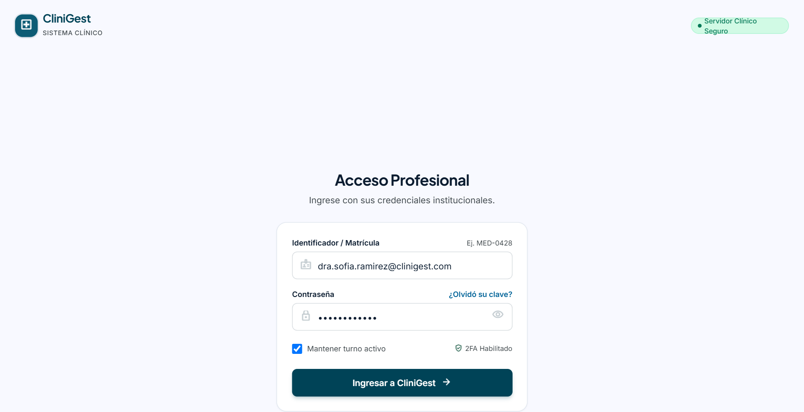
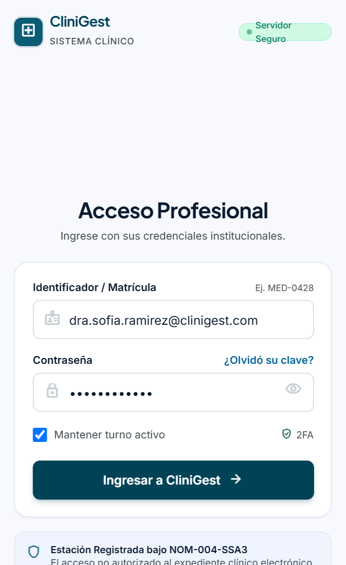
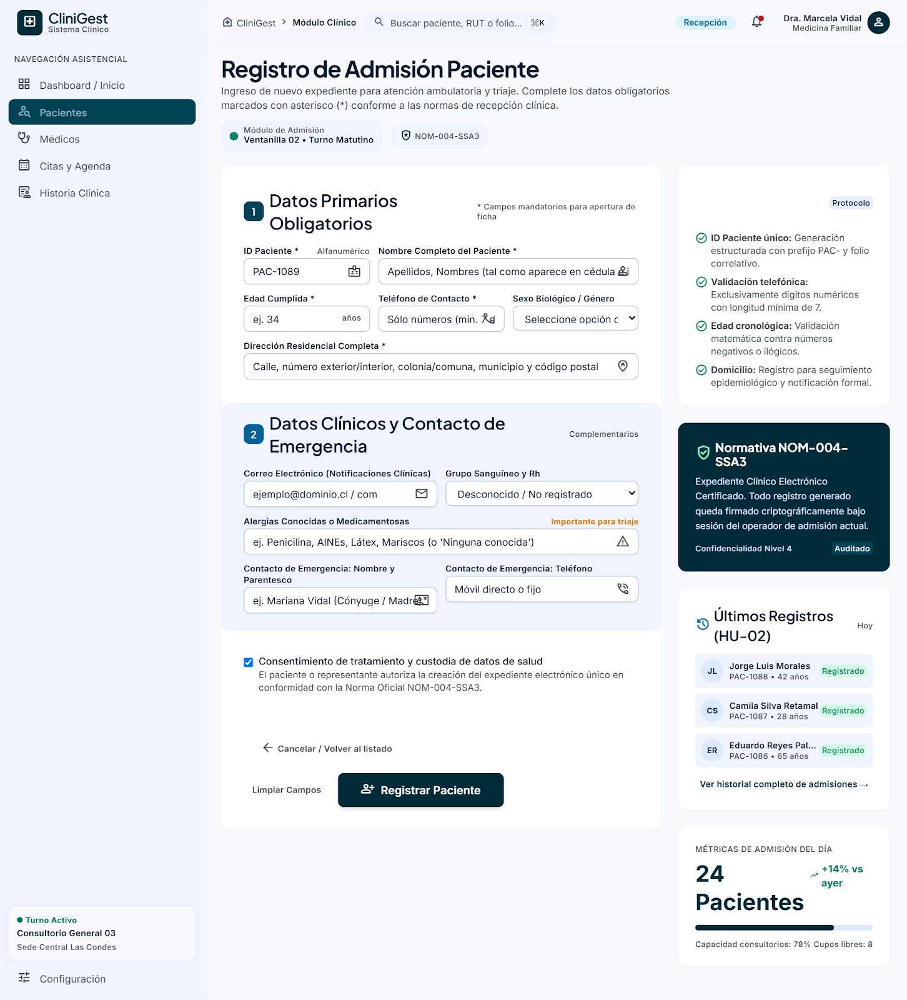
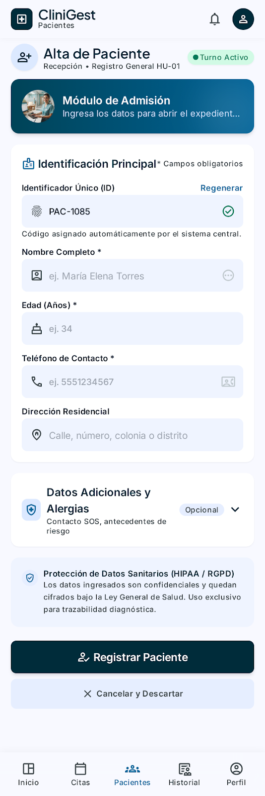
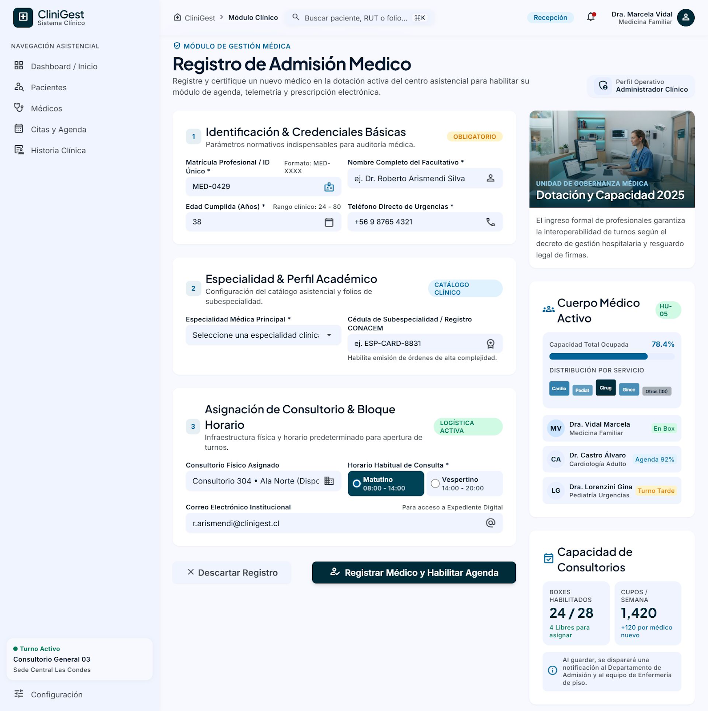
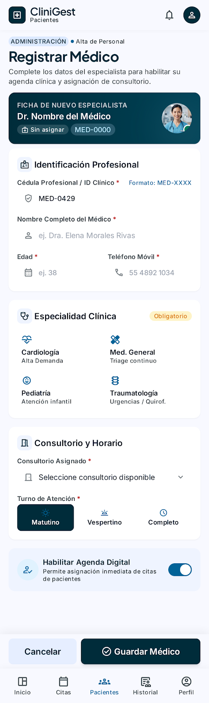
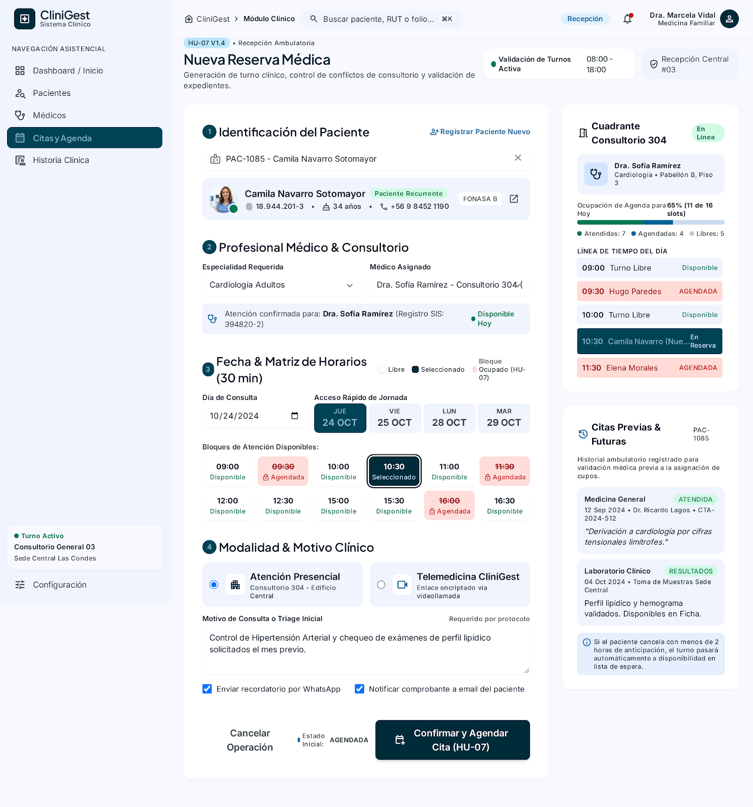
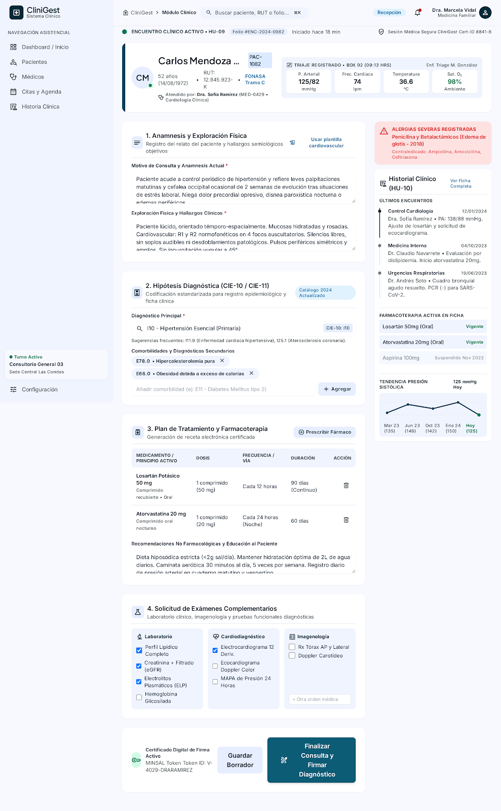
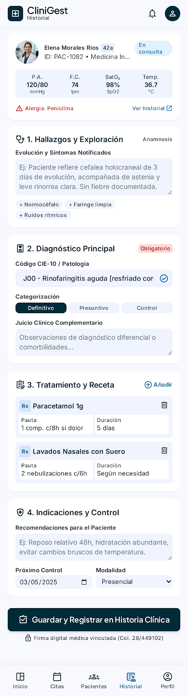

# FASE 5 – DISEÑO DE INTERFAZ DE USUARIO Y EXPERIENCIA DE USUARIO (UI/UX)
## Sistema de Gestión de Clínica Médica (SGCM - MVP)

**Autores:** Fabián Trujillo, Alexandra Garzón  
**Trazabilidad:** Historias de Usuario (HU-01 a HU-10), ERS IEEE 830 (V6), Reglas de Negocio (RN-01 a RN-08), Modelo Relacional de Base de Datos (Fase 4).  
**Design System:** *Clinical Clarity* (Arquitectura de Diseño Clínico Moderno)  
**Herramienta de Prototipado:** Google Stitch / HTML5 Semántico + Tailwind CSS 3.4 + Material Symbols  

---

## 📌 1. Introducción y Enfoque de Diseño

La **Fase 5 (UI/UX)** consolida la especificación visual y la arquitectura de interacción para el **Sistema de Gestión de Clínica Médica (SGCM)**. El diseño ha sido construido siguiendo principios rigurosos de **accesibilidad clínica (WCAG 2.1 Nivel AA)**, ergonomía visual para reducir la fatiga cognitiva del personal asistencial y administrativo, y un diseño adaptativo (*Mobile-First* y *Desktop High-Density*) que garantiza una operación fluida tanto en estaciones de trabajo de escritorio como en tabletas y dispositivos móviles de consultorio o triaje.

---

## 🎨 2. Design System: *Clinical Clarity*

El sistema visual implementa tokens de diseño estrictos basados en la identidad visual **CliniGest**:

### Paleta Cromática y Tokens Semánticos

| Rol de Color | Hexadecimal | Uso en Interfaz |
| :--- | :---: | :--- |
| **Primary (Deep Cyan / Navy)** | `#002C3A` | Barras de navegación, encabezados principales, botones de acción primaria y énfasis estructural. |
| **Primary Container** | `#0D5C75` | Estados activos de navegación, encabezados de tarjetas clínicas y contenedores destacados. |
| **Secondary (Medical Blue)** | `#016398` | Botones de acción secundaria, enlaces interactivos, indicadores de progreso y tabs seleccionadas. |
| **Background / Canvas** | `#F8FAFC` | Fondo de aplicación general (Slate 50), diseñado para evitar el deslumbramiento en jornadas extensas. |
| **Surface White** | `#FFFFFF` | Tarjetas de contenido, modales, formularios y filas de tablas de datos. |
| **Border Subtle** | `#E2E8F0` | Separadores de campos, bordes de tarjetas y divisiones de tablas de alta legibilidad. |
| **Status Scheduled** | `#0369A1` / `#E0F2FE` | Citas agendadas y confirmadas en espera de llegada. |
| **Status In-Waiting (Espera)** | `#D97706` / `#FEF3C7` | Pacientes recepcionados en sala de espera activa (alerta operativa). |
| **Status Attended (Atendida)** | `#047857` / `#D1FAE5` | Consultas completadas, diagnóstico registrado y expediente cerrado. |
| **Status Canceled (Cancelada)** | `#DC2626` / `#FEE2E2` | Citas canceladas con cupo liberado para reasignación inmediata. |

### Tipografía Institucional

- **Headlines y Títulos:** `Plus Jakarta Sans` (pesos 600, 700, 800) para jerarquía médica clara y moderna.
- **Cuerpo, Formularios y Tablas:** `Inter` (pesos 400, 500, 600) optimizada para lectura en pantallas de alta densidad de información.
- **Iconografía:** `Material Symbols Outlined` con trazado uniforme de 24px/20px.

---

## 📐 3. Arquitectura de Pantallas y Resoluciones

| Form Factor | Resolución Base | Breakpoint | Target de Usuario |
| :--- | :---: | :---: | :--- |
| **Desktop** | $1440 \times 900$ / $2560 \times 1440$ | `xl:col-span-8`, `lg:flex` | Estaciones fijas de recepción central, boxes médicos y pantallas de administración. |
| **Mobile** | $390 \times 844$ (iPhone 14/15) / $412 \times 915$ | `< 768px` | Personal en ronda asistencial, médicos en tránsito, tablets de triaje y admisión rápida. |

---

## 📂 4. Estructura Completa de Entregables en la Fase 5

El catálogo de pantallas y prototipos sigue una secuencia ordenada de 9 etapas de diseño de interfaz:

```text
docs/phase-5-ui-ux/
├── README.md                                                  # Índice maestro y especificación técnica UI/UX
├── estructura-navegacion/                                     # 01. Arquitectura de información y mapas de navegación
│   ├── README.md                                              # Especificación técnica, RBAC y flujos de navegación
│   ├── desktop/                                               # Diagramas y vistas de navegación en estación fija (Sidebar)
│   └── mobile/                                                # Flujos táctiles, Bottom Navigation Bar y Drawer
├── pantalla-inicio/                                           # 02. Pantalla de inicio, bienvenida y accesos rápidos
│   ├── README.md                                              # Especificación del portal de bienvenida y métricas de turno
│   ├── desktop/                                               # Hero banner, accesos rápidos y panel de avisos
│   └── mobile/                                                # Resumen vertical compacto y botones de acción primaria
├── login/                                                     # 03. Acceso institucional seguro y autenticación
│   ├── README.md                                              # Especificación de seguridad, credenciales y RBAC
│   ├── desktop/
│   │   └── login.png                                          # Pantalla de acceso en estación clínica de escritorio
│   └── mobile/
│       └── login.png                                          # Pantalla de acceso responsiva para dispositivos móviles
├── dashboard/                                                 # 04. Cuadros de mando por rol (Recepción, Médico, Admin)
│   ├── README.md                                              # Especificación de salas de espera, ocupación y métricas
│   ├── desktop/                                               # Tablero de control de alta densidad y KPIs
│   └── mobile/                                                # Tarjetas de flujo de pacientes y segmentadores táctiles
├── formularios/                                               # 05. Mockups en alta fidelidad de formularios de negocio
│   ├── README.md                                              # Directrices de campos, validaciones y accesibilidad
│   ├── desktop/                                               # Vistas de escritorio (1440px+)
│   │   ├── hu_01_registrar_paciente_desktop.png               # Formulario de admisión y datos de paciente
│   │   ├── hu_04_registrar_medico_desktop.png                 # Alta médica, especialidad y credenciales
│   │   ├── hu_07_agendar_cita_desktop.png                     # Agendamiento de citas y validación de franjas
│   │   └── hu_09_registrar_diagnostico_y_tratamiento_desktop.png # Ficha de consulta médica y prescripción
│   └── mobile/                                                # Vistas móviles (390px - 412px)
│       ├── hu_01_registrar_paciente_mobile.png                # Admisión optimizada para scroll vertical táctil
│       ├── hu_04_registrar_medico_mobile.png                  # Alta médica adaptada a tarjeta móvil
│       ├── hu_07_agendar_cita_mobile.png                      # Selector de citas y horarios en una columna
│       └── hu_09_registrar_diagnostico_y_tratamiento_mobile.png # Evolución médica y signos vitales táctil
├── listados/                                                  # 06. Tablas de datos maestras y directorios clínicos
│   ├── README.md                                              # Especificación de tablas, ordenamiento y paginación
│   ├── desktop/                                               # Tablas de pacientes (HU-02), médicos (HU-05) y citas (HU-08)
│   └── mobile/                                                # Tarjetas condensadas con acciones rápidas táctiles
├── consultas/                                                 # 07. Búsquedas predictivas, filtros y disponibilidad
│   ├── README.md                                              # Búsqueda global (Ctrl+K), filtros multicriterio y slots
│   ├── desktop/                                               # Sidebar de filtros y grilla de disponibilidad médica
│   └── mobile/                                                # Chips deslizables y panel inferior Bottom Sheet
├── detalle-registros/                                         # 08. Expediente clínico, evolución y vistas de detalle
│   ├── README.md                                              # Ficha integral de paciente, consulta (HU-10) e historial
│   ├── desktop/                                               # Vista a 3 columnas con timeline cronológico interactivo
│   └── mobile/                                                # Pestañas deslizables y acordeones colapsables
└── mensajes-error-confirmacion/                               # 09. Modales de confirmación, toasts y estados vacíos
    ├── README.md                                              # Catálogo de alertas, confirmaciones críticas y error 404/500
    ├── desktop/                                               # Modales con desenfoque de fondo y toasts de cuadrante
    └── mobile/                                                # Bottom sheets destructivos y alertas contextuales
```

---

## 🖼️ 5. Catálogo Visual y Especificación de Módulos

### 5.1. Definir Estructura de Navegación
- **Especificación Completa:** [estructura-navegacion/README.md](./estructura-navegacion/README.md)
- **Alcance:** Arquitectura de información, jerarquía por roles RBAC, Sidebar colapsable con accesos rápidos (Desktop) y Bottom Navigation Bar con Drawer deslizable (Mobile).
- **Assets:** `estructura-navegacion/desktop/` y `estructura-navegacion/mobile/`.

---

### 5.2. Diseñar Pantalla de Inicio (Portal de Bienvenida)
- **Especificación Completa:** [pantalla-inicio/README.md](./pantalla-inicio/README.md)
- **Alcance:** Pantalla de aterrizaje post-login con saludo contextual, resumen de métricas del turno (citas del día, sala de espera activa), acciones rápidas (*Quick Actions*) y tablón de anuncios clínicos.
- **Assets:** `pantalla-inicio/desktop/` y `pantalla-inicio/mobile/`.

---

### 5.3. Login / Acceso Institucional y Autenticación
- **Especificación Completa:** [login/README.md](./login/README.md)
- **Trazabilidad:** Precondición transversal de seguridad para la ejecución de Casos de Uso (`CU-01` a `CU-10`) | Control de Acceso Basado en Roles (RBAC: Recepcionista, Médico, Administrador) | RNF-01 (Seguridad y Privacidad de Datos Clínicos).
- **Componentes:** Formulario de inicio de sesión seguro, campo de credencial institucional, contraseña con alternancia de visibilidad, selector de rol asistencial, validación en tiempo real y enlaces de soporte.

#### Vista Desktop


#### Vista Mobile


---

### 5.4. Dashboard Operativo por Rol
- **Especificación Completa:** [dashboard/README.md](./dashboard/README.md)
- **Alcance:** Centros de mando especializados: Recepción (control de sala de espera activa y check-in), Médico (cola de espera por box y llamado de paciente), Administración (ocupación y métricas operativas).
- **Assets:** `dashboard/desktop/` y `dashboard/mobile/`.

---

### 5.5. Formularios de Negocio
- **Especificación Completa:** [formularios/README.md](./formularios/README.md)

#### HU-01: Registrar Paciente (Admisión e Identificación)
- **Trazabilidad:** HU-01 | RF-01 | Entidad BD: `pacientes` | Regla: Formato ID `PAC-<cédula>` (ej. `PAC-1020029712`).
- **Campos Principales:** Tipo y número de documento, nombres y apellidos, fecha de nacimiento, sexo biológico, teléfono, correo electrónico, dirección, tipo de seguro/cobertura y contacto de emergencia.

*Vista Desktop:*  


*Vista Mobile:*  


#### HU-04: Registrar Médico (Alta de Profesionales de la Salud)
- **Trazabilidad:** HU-04 | RF-04 | Entidad BD: `medicos` | Regla: Cédula profesional única, especialidad médica válida y asignación de box.
- **Campos Principales:** Nombres, apellidos, número de colegiado/registro médico, especialidad (Cardiología, Medicina General, Pediatría, etc.), teléfono de contacto, correo institucional, box de atención y horario de turnos.

*Vista Desktop:*  


*Vista Mobile:*  


#### HU-07: Agendar Cita Médica (Gestión de Agenda y Cupos)
- **Trazabilidad:** HU-07 | RF-07 | Entidad BD: `citas` | Regla: No traslape de horarios para el mismo médico (RN-02) ni doble cita simultánea para el paciente.
- **Campos Principales:** Selector de paciente con autocompletado por cédula/RUT, selector de especialidad y médico tratante, calendario interactivo de disponibilidad, franja horaria (slots de 30 minutos), motivo de consulta y tipo de atención.

*Vista Desktop:*  


*Vista Mobile:*  


#### HU-09: Registrar Diagnóstico y Tratamiento (Atención Clínica)
- **Trazabilidad:** HU-09, HU-10 | RF-09, RF-10 | Entidades BD: `consultas`, `expedientes_clinicos`, `recetas` | Regla: Solo el médico asignado puede registrar la atención cuando la cita está en estado confirmada/en espera.
- **Campos Principales:** Signos vitales (PA, FC, Temp, SatO2, Peso/Talla), motivo de consulta detallado, anamnesis y exploración física, diagnóstico principal (código CIE-10 / descripción), plan de tratamiento, prescripción farmacológica y firma digital.

*Vista Desktop:*  


*Vista Mobile:*  


---

### 5.6. Listados y Tablas de Datos
- **Especificación Completa:** [listados/README.md](./listados/README.md)
- **Alcance:** Directorios maestros de Pacientes (HU-02), Directorio Médico (HU-05) y Agenda Diaria de Citas (HU-08). Implementa tablas de alta densidad con ordenamiento y paginación en Desktop, y tarjetas condensadas táctiles en Mobile.
- **Assets:** `listados/desktop/` y `listados/mobile/`.

---

### 5.7. Consultas y Búsquedas Avanzadas
- **Especificación Completa:** [consultas/README.md](./consultas/README.md)
- **Alcance:** Búsqueda global predictiva con atajo `Ctrl + K`, panel de filtros multicriterio (rango de fechas, estado, especialidad, médico) y visualizador interactivo de disponibilidad de franjas horarias médicas sin colisiones (RN-02).
- **Assets:** `consultas/desktop/` y `consultas/mobile/`.

---

### 5.8. Detalle de Registros y Expediente Clínico
- **Especificación Completa:** [detalle-registros/README.md](./detalle-registros/README.md)
- **Alcance:** Ficha integral del paciente con banner de alerta de alergias críticas en rojo, detalle de consulta médica (HU-10), visualizador cronológico de evolución (*Timeline*) y formato de receta médica para impresión.
- **Assets:** `detalle-registros/desktop/` y `detalle-registros/mobile/`.

---

### 5.9. Mensajes de Error, Confirmación y Feedback
- **Especificación Completa:** [mensajes-error-confirmacion/README.md](./mensajes-error-confirmacion/README.md)
- **Alcance:** Modales de confirmación crítica (cancelación de cita con motivo obligatorio RN-03), notificaciones flotantes Toast (Éxito, Advertencia, Error, Info), validación inline en campos y páginas de estado del sistema (404, 403, 500).
- **Assets:** `mensajes-error-confirmacion/desktop/` y `mensajes-error-confirmacion/mobile/`.

---

## ♿ 6. Criterios de Accesibilidad y Buenas Prácticas UI/UX

1. **Contraste de Color:** Todas las combinaciones de texto y fondo cumplen con el ratio de contraste mínimo de $4.5:1$ para texto estándar y $3:1$ para componentes interactivos y texto grande (WCAG AA).
2. **Jerarquía Visual y Densidad de Información:** Se utiliza espaciado modular de 8px (Tailwind 4, 6, 8, 12, 16) con tarjetas delimitadas por bordes sutiles para facilitar el escaneo rápido de datos clínicos.
3. **Áreas Táctiles en Móvil:** Los botones y campos de entrada en resolución móvil tienen una altura mínima de 44px (`h-11`) para garantizar pulsaciones cómodas sin errores.
4. **Validación Visual de Estados:** Cada campo cuenta con retroalimentación clara de foco, estados de error con mensajes explicativos y badges semánticos con micro-iconos para daltonismo y accesibilidad.
