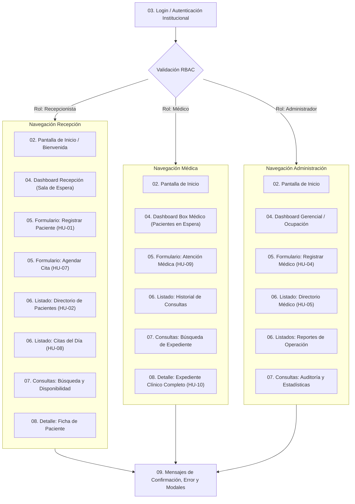

# 01. Estructura de Navegación y Arquitectura de Información (SGCM)

**Fase:** Fase 5 – UI/UX & Prototipado  
**Módulo:** Estructura de Navegación  
**Design System:** *Clinical Clarity*  
**Trazabilidad:** Precondición transversal de navegación para CU-01 a CU-10 | RBAC (Recepción, Médico, Admin) | ERS V6 Sección 3.1  

---

## 📌 1. Propósito del Módulo

Definir la arquitectura de navegación, jerarquía espacial y patrones de interacción del **Sistema de Gestión de Clínica Médica (SGCM)**. El objetivo es minimizar la carga cognitiva del usuario, permitiendo acceder a cualquier función clínica o administrativa en un máximo de **2 clics en Desktop** o **2 toques en Mobile**.

---

## 🗺️ 2. Mapa de Navegación y Flujo de Interacción

---

## 🖥️ 3. Especificación Desktop ($1440 \times 900$ px)

### Componentes Principales:
1. **Sidebar Lateral Izquierda (240px de ancho fijo):**
   - Logotipo institucional **CliniGest** con isotipo médico en Primary `#002C3A`.
   - Menú de navegación agrupado por secciones:
     - *Principal:* Inicio, Dashboard.
     - *Gestión Asistencial:* Citas, Pacientes, Consultas Médicas.
     - *Administración:* Médicos, Boxes, Configuración.
   - Indicador de estado activo con píldora redondeada en `#0D5C75` y texto en alto contraste `#FFFFFF`.
   - Botón inferior de colapso rápido (modo icono de 68px de ancho) para maximizar área de trabajo en registros extensos.
2. **Top Header Bar (64px de alto):**
   - Breadcrumbs dinámicos (ej: *Inicio > Pacientes > Ficha PAC-1020029712*).
   - Buscador global integrado con atajo de teclado (`Ctrl + K`).
   - Selector de sede/sucursal médica.
   - Centro de notificaciones con badge de alertas clínicas pendientes.
   - Widget de perfil con avatar, nombre, rol asistencial y menú desplegable para cierre de sesión seguro.
3. **Canvas de Trabajo Principal:**
   - Contenedor fluido con ancho máximo de 1440px y espaciado lateral de 32px (`p-8`).

---

## 📱 4. Especificación Mobile ($390 \times 844$ px)

### Componentes Principales:
1. **Top App Bar (56px de alto):**
   - Botón de menú hamburguesa (despliega Drawer lateral para opciones secundarias y cierre de sesión).
   - Logotipo CliniGest simplificado (isotipo + texto 18px).
   - Botón de búsqueda rápida y botón de notificaciones.
2. **Bottom Navigation Bar (64px de alto con padding inferior seguro para iPhone/Android):**
   - 4 accesos directos principales con etiqueta e icono Material Symbols (24px):
     1. **Inicio** (`home`)
     2. **Agenda** (`calendar_today`)
     3. **Pacientes** (`group`)
     4. **Mi Turno / Box** (`medical_services` / `person`)
   - Área táctil de cada ítem de mínimo $48 \times 48$ px para cumplimiento WCAG AA.
3. **Navigation Drawer Deslizable:**
   - Muestra el perfil completo, cambio de sede, directorio médico, manual de ayuda y botón rojo para cerrar sesión.

---

## 📂 5. Directorios de Assets y Prototipos

- `desktop/`: Almacena diagramas de estructura, capturas y mockups de navegación para pantallas de escritorio.
- `mobile/`: Almacena diagramas de flujos táctiles, vistas de Bottom Navigation y Drawer para móviles.
