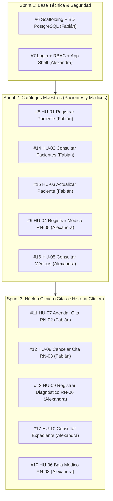

# 🚀 FASE 6 – IMPLEMENTACIÓN DE CÓDIGO FUNCIONAL (`phase-6-code`)
## Tablero de Control, Asignación de Issues y Flujo de Ramas (SGCM - MVP)

**Rama Base de Integración:** [`phase-6-code`](https://github.com/Trujillo7915/Sistema_Clinica_Medica/tree/phase-6-code)  
**Milestone en GitHub:** [Fase 6: Implementacion de Codigo Funcional (phase-6-code)](https://github.com/Trujillo7915/Sistema_Clinica_Medica/milestone/1)  
**Tablero de Issues en Vivo:** [Todos los Issues de Fase 6 (12 abiertos)](https://github.com/Trujillo7915/Sistema_Clinica_Medica/issues?q=is%3Aissue+is%3Aopen+label%3Aphase-6-code)

---

## 👥 1. Vistas Rápidas por Integrante en GitHub

* 👨‍💻 **Fabián Trujillo (`@Trujillo7915` — 6 Issues):**  
  👉 [Ver mis Issues asignados en GitHub](https://github.com/Trujillo7915/Sistema_Clinica_Medica/issues?q=is%3Aissue+is%3Aopen+assignee%3ATrujillo7915)
* 👩‍💻 **Alexandra Garzón (`@AlexandraVargass` — 6 Issues):**  
  👉 [Ver mis Issues asignados en GitHub](https://github.com/Trujillo7915/Sistema_Clinica_Medica/issues?q=is%3Aissue+is%3Aopen+assignee%3AAlexandraVargass)

---

## 📋 2. Matriz Oficial de Issues de la Fase 6 (12 Issues Equitativos)

### 👨‍💻 Asignados a Fabián Trujillo (`@Trujillo7915`)

| Issue | HU / RF | Épica | Prioridad | Rama Feature Sugerida | Título y Alcance |
| :---: | :---: | :--- | :---: | :--- | :--- |
| **[#6](https://github.com/Trujillo7915/Sistema_Clinica_Medica/issues/6)** | Base / Setup | `epic:arquitectura` | **Must Have** | `chore/6-scaffolding-bd` | `chore(arquitectura): scaffolding backend/frontend, conexion PostgreSQL y configuracion .env (Fase 6)` |
| **[#8](https://github.com/Trujillo7915/Sistema_Clinica_Medica/issues/8)** | `HU-01` / `RF-01` | `epic:pacientes` | **Must Have** | `feature/8-hu01-registrar-paciente` | `feat(pacientes): registrar nuevo paciente con validacion RN-01, RN-04 y apertura de expediente` |
| **[#14](https://github.com/Trujillo7915/Sistema_Clinica_Medica/issues/14)** | `HU-02` / `RF-02` | `epic:pacientes` | **Must Have** | `feature/14-hu02-consultar-pacientes` | `feat(pacientes): consultar directorio de pacientes y busqueda predictiva Ctrl+K` |
| **[#15](https://github.com/Trujillo7915/Sistema_Clinica_Medica/issues/15)** | `HU-03` / `RF-03` | `epic:pacientes` | **Should Have** | `feature/15-hu03-actualizar-paciente` | `feat(pacientes): actualizar datos de contacto y direccion de paciente existente` |
| **[#11](https://github.com/Trujillo7915/Sistema_Clinica_Medica/issues/11)** | `HU-07` / `RF-07` | `epic:citas` | **Must Have (Crítica)** | `feature/11-hu07-agendar-cita-rn02` | `feat(citas): agendar cita medica con control de colisiones de horario RN-02 y dashboard recepcion` |
| **[#12](https://github.com/Trujillo7915/Sistema_Clinica_Medica/issues/12)** | `HU-08` / `RF-08` | `epic:citas` | **Should Have** | `feature/12-hu08-cancelar-cita-rn03` | `feat(citas): cancelar cita agendada con liberacion de cupo horario RN-03` |

---

### 👩‍💻 Asignados a Alexandra Garzón (`@AlexandraVargass`)

| Issue | HU / RF | Épica | Prioridad | Rama Feature Sugerida | Título y Alcance |
| :---: | :---: | :--- | :---: | :--- | :--- |
| **[#7](https://github.com/Trujillo7915/Sistema_Clinica_Medica/issues/7)** | Auth / RBAC | `epic:arquitectura` | **Must Have** | `feature/7-auth-rbac-shell` | `feat(auth): autenticacion institucional, sesion y control de acceso por roles RBAC (Login & Navegacion)` |
| **[#9](https://github.com/Trujillo7915/Sistema_Clinica_Medica/issues/9)** | `HU-04` / `RF-04` | `epic:medicos` | **Must Have** | `feature/9-hu04-registrar-medico` | `feat(medicos): registrar nuevo medico con validacion de especialidad y edad laboral RN-05` |
| **[#16](https://github.com/Trujillo7915/Sistema_Clinica_Medica/issues/16)** | `HU-05` / `RF-05` | `epic:medicos` | **Must Have** | `feature/16-hu05-consultar-medicos` | `feat(medicos): consultar catalogo de medicos y filtro por especialidad` |
| **[#10](https://github.com/Trujillo7915/Sistema_Clinica_Medica/issues/10)** | `HU-06` / `RF-06` | `epic:medicos` | **Could Have** | `feature/10-hu06-eliminar-medico-rn08` | `feat(medicos): eliminar o dar de baja medico validando bloqueo por citas futuras agendadas RN-08` |
| **[#13](https://github.com/Trujillo7915/Sistema_Clinica_Medica/issues/13)** | `HU-09` / `RF-09` | `epic:historia-clinica` | **Must Have** | `feature/13-hu09-registrar-consulta-rn06` | `feat(historia-clinica): registrar diagnostico y tratamiento con transicion automatica a ATENDIDA RN-06` |
| **[#17](https://github.com/Trujillo7915/Sistema_Clinica_Medica/issues/17)** | `HU-10` / `RF-10` | `epic:historia-clinica` | **Must Have** | `feature/17-hu10-consultar-expediente` | `feat(historia-clinica): consultar expediente clinico cronologico del paciente y evolucion medica` |

---

## 🔄 3. Orden de Ejecución Recomendado (Sprints Internos)



---

## 🛠️ 4. Cómo Trabajar Cada Issue (Paso a Paso)

1. **Ubicarse siempre en `phase-6-code` actualizado:**
   ```bash
   git checkout phase-6-code
   git pull origin phase-6-code
   ```
2. **Crear la rama del Issue que vas a trabajar:**
   ```bash
   # Ejemplo para el Issue #8 (HU-01):
   git checkout -b feature/8-hu01-registrar-paciente
   ```
3. **Programar siguiendo TDD (`>= 80%` cobertura) y hacer commit referenciando el Issue:**
   ```bash
   git add .
   git commit -m "feat(pacientes): implementar registro de paciente HU-01 con validacion RN-04 (closes #8)"
   git push -u origin feature/8-hu01-registrar-paciente
   ```
4. **Abrir Pull Request hacia `phase-6-code`:**
   * Base branch: `phase-6-code` ← Compare branch: `feature/8-hu01-registrar-paciente`.
   * Al hacer merge a `phase-6-code`, el Issue `#8` se mueve automáticamente a **Done / Closed** en el Milestone y en GitHub Projects.

---

## 📊 5. Sincronización con GitHub Projects V2 (Kanban Visual)

Para crear y poblar automáticamente el tablero **GitHub Projects V2** con los 12 Issues desde la terminal, ejecuta una sola vez:

```powershell
# 1. Autorizar el permiso 'project' en GitHub CLI (abre código en navegador):
gh auth refresh -s project,read:project

# 2. Ejecutar el script automatizado que crea el Project y agrega los Issues #6 al #17:
powershell -ExecutionPolicy Bypass -File .\docs\phase-6-code\sync-github-project.ps1
```
