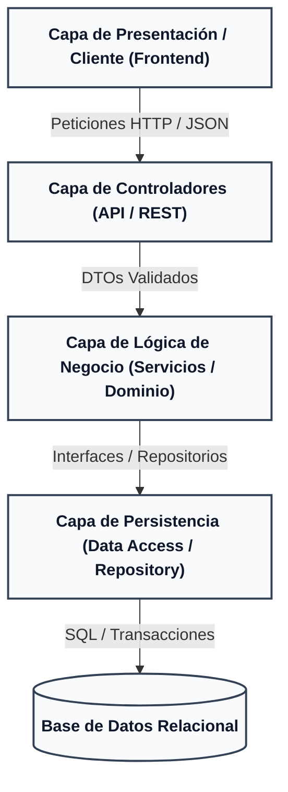
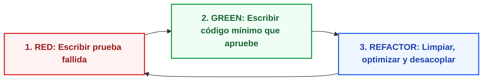

# MANUAL TÉCNICO DE DESARROLLO Y ONBOARDING
## Sistema de Gestión de Clínica Médica (SGCM)

Este manual proporciona la guía técnica integral para que cualquier desarrollador configure su entorno, comprenda la arquitectura de la solución y aplique los flujos de desarrollo establecidos.

---

## 1. Arquitectura de la Solución (Diseño en Capas)

El sistema adopta una **Arquitectura en Capas Limpia (Clean Layered Architecture)** para desacoplar responsabilidades y facilitar las pruebas automatizadas:



### Responsabilidades por Capa:
1. **Capa de Presentación (Frontend):** Vistas web accesibles, formularios con validación previa y manejo de estados.
2. **Capa de Controladores (REST Controllers):** Enrutamiento de peticiones HTTP, autenticación de sesión y mapeo de DTOs.
3. **Capa de Negocio (Services & Domain):** Implementación estricta de las reglas de negocio (RN-01 a RN-08), invariantes, orquestación de transacciones y cálculos.
4. **Capa de Persistencia (Repositories):** Consultas SQL preparadas, mapeo objeto-relacional y control de concurrencia.
5. **Capa de Base de Datos:** Integridad referencial con claves primarias, foráneas y restricciones `CHECK`/`UNIQUE`.

---

## 2. Requisitos Previos e Instalación

Para ejecutar y colaborar en el proyecto se requieren las siguientes herramientas instaladas localmente:

* **Control de versiones:** Git 2.30+
* **Motor de Base de Datos:** PostgreSQL 14+ (o SQLite 3 para pruebas locales ligeras).
* **Entorno de ejecución / Runtime:** Node.js LTS (v18+) o Java JDK 17+ (según el stack que se determine en Fase 6).
* **Cliente de Base de Datos:** DBeaver, pgAdmin o extensión de VSCode/IDE.

---

## 3. Metodología de Desarrollo Guiado por Pruebas (TDD)

Es obligatorio adoptar el flujo **TDD (Test-Driven Development)**:



1. **RED:** Escribir una prueba unitaria basada en el criterio Given-When-Then de la Historia de Usuario correspondiente. La prueba debe fallar inicialmente.
2. **GREEN:** Implementar el código más sencillo y limpio que satisfaga la prueba.
3. **REFACTOR:** Eliminar duplicidad, mejorar nombres, garantizar inmutabilidad y verificar que la cobertura se mantenga sobre el **80%**.

---

## 4. Estructura de Directorios del Repositorio

```
├── docs/                     # Especificación del ciclo de vida (Fases 1 a 5)
│   ├── phase-1-user-story/   # Épicas, historias de usuario y MoSCoW
│   ├── phase-2-requirements/ # ERS IEEE 830 y Matriz de Trazabilidad
│   ├── phase-3-uml/          # Casos de uso, clases, secuencia y actividades
│   ├── phase-4-bd/           # Documentación paso a paso, DDL/DML y modelos SVG
│   ├── phase-5-mockups/      # Wireframes y prototipos UI
│   └── standards/            # Manuales de desarrollo, reglas y buenas prácticas
├── src/                      # Código fuente de la solución (Fase 6)
│   ├── backend/              # Lógica de servidor y APIs
│   └── frontend/             # Interfaz de usuario
├── board-workflow.md         # Flujo general del proyecto
└── README.md                 # Presentación y estado actual del sistema
```
